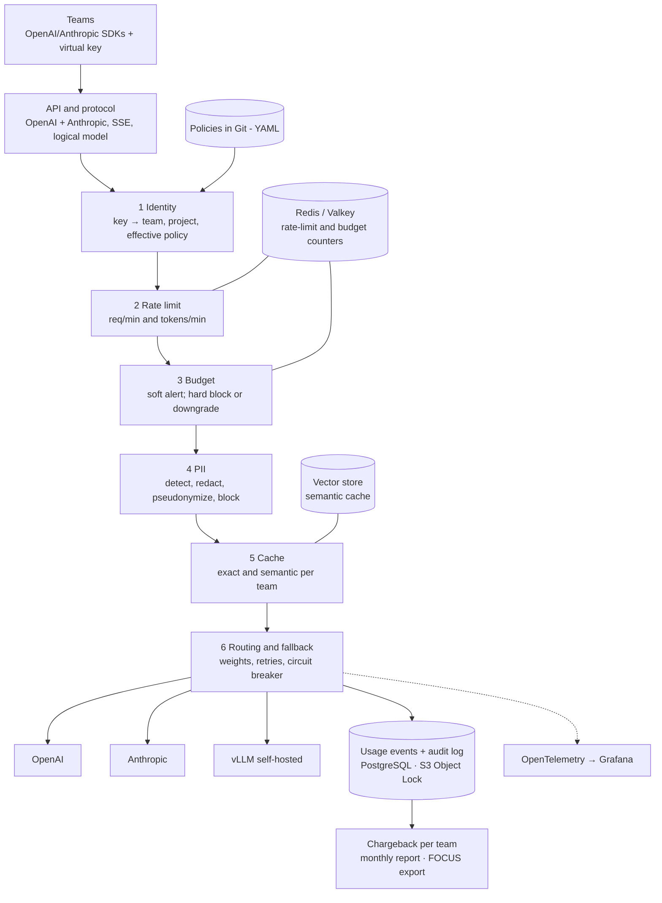

# Tollgate — Spec Kit Playbook for Claude Code

> **Tollgate — an LLM gateway with platform policies.** A Go gateway between engineering teams and model providers (OpenAI, Anthropic, self-hosted) that enforces per-team rate limits and budgets, attributes every token to a cost owner (chargeback, FOCUS export), fails over between providers, caches exact and semantically similar requests, redacts PII, and writes a tamper-evident audit log — with a reproducible report that measures what each policy costs in latency and saves in dollars.

This document is written **for Claude Code** and executed by it end to end, without human interaction. The human maintainer reviews the resulting pull requests afterwards.

---

## 0. For the human (read once, 2 minutes)

**Prerequisites on your Mac:** Homebrew, a GitHub account, `gh auth login` already done (scopes: `repo`, `workflow`, `read:org`), Docker Desktop (or Colima), Claude Code installed.

**Start the run** from `/Users/hermeto/GitHub/hermeto` — the repository will live at `/Users/hermeto/GitHub/hermeto/tollgate`:

```bash
mkdir -p /Users/hermeto/GitHub/hermeto && cd /Users/hermeto/GitHub/hermeto
cp /Users/hermeto/Downloads/tollgate-speckit-playbook.md ./tollgate-speckit-playbook.md

# Hide paid-provider and cloud credentials: v1.0 uses simulated providers only.
env -u OPENAI_API_KEY -u ANTHROPIC_API_KEY -u AZURE_OPENAI_API_KEY \
    -u AWS_PROFILE -u AWS_ACCESS_KEY_ID -u AWS_SECRET_ACCESS_KEY -u AWS_SESSION_TOKEN \
    -u GOOGLE_APPLICATION_CREDENTIALS \
    AWS_CONFIG_FILE=/dev/null AWS_SHARED_CREDENTIALS_FILE=/dev/null \
  claude --permission-mode acceptEdits
```

Then paste this single prompt:

```text
Read ./tollgate-speckit-playbook.md completely and execute it end to end, autonomously.
Do not ask me questions; follow the playbook's decision rules and record every decision.
Stop only when every feature in Section 6 has an open pull request, or when a hard stop
in Section 2 applies.
```

If the session ends early (context or time limit), start a new session in `/Users/hermeto/GitHub/hermeto/tollgate` with:

```text
Read docs/agent/PLAYBOOK.md and docs/agent/PROGRESS.md, then resume from the next unfinished step.
```

**Reviewing afterwards:** PRs are **stacked** (each feature branches from the previous one). Review and merge **bottom-up** in the order listed in the tracking issue "v1.0 roadmap". When a PR is merged with "delete branch", GitHub retargets the next PR to `main` automatically.

**What the agent will NOT do:** call real model providers (OpenAI, Anthropic, Azure, Bedrock) or any paid API, create cloud resources, merge PRs, push to `main` after the bootstrap commit, or change repository visibility. Validation with real providers and partner companies is explicitly **post-v1.0** (Appendix A §A.9).

---

## 1. Mission and inputs for the agent

You are the sole engineer building **Tollgate**, an open-source LLM gateway with platform policies (governance and FinOps for AI). The product specification is **Appendix A** (copy it into the repo as `docs/product/spec.md`). The constitution is **Appendix B**. The feature backlog is **Section 6**, in dependency order.

Your outputs are: a public GitHub repository with open-source best practices, one Spec Kit feature per backlog item, and one pull request per feature (plus follow-up PRs per iteration), each green in CI and ready for review.

---

## 2. Operating rules (non-negotiable)

### 2.1 Autonomy and decisions

1. **Never wait for the human.** When a Spec Kit step asks questions (e.g. `/speckit-clarify`), answer them yourself using Appendix A, the constitution and the product goals. Prefer the option that is simplest, keeps the `local` profile working with simulated providers, keeps the hot path fast, and is easiest to measure.
2. **Record every decision** you make on the human's behalf:
   - in the feature's `spec.md` under `## Clarifications` (format: `- Q: … → A: … (decided by agent: <one-line rationale>)`);
   - as an ADR in `docs/adr/` when the decision is architectural (Section 6 names the expected ADRs);
   - in the PR description under **"Decisions for the reviewer"**.
3. **Blocked?** If a task truly cannot be completed, do not stop the run: open an issue labeled `needs-human` describing the blocker and options, reference it in the PR, mark affected tasks `[~]` with a link in `tasks.md`, and continue with the next feature.
4. **Versions:** resolve the **latest stable** release of every tool, library, image and action at implementation time, then **pin** it (go.mod/go.sum, uv.lock, image digests, action SHAs). Never use `latest` tags.
5. **Verify upstream contracts** before coding against them: OpenAI Chat Completions/Embeddings and streaming chunk format, Anthropic Messages API and its streaming events, OpenTelemetry GenAI semantic conventions (still in development; normalize names in one package), FOCUS specification version, Envoy `ext_proc` protocol and Envoy Gateway / Agent Router extension APIs. Read the official docs or SDK source for the pinned versions; cite URLs in the plan's `research.md`. Record real wire formats as **fixtures** (from official SDK test suites or docs examples), never by calling paid APIs.

### 2.2 Hard stops — never do these

- No calls to real model providers or any paid API. Every test, benchmark and demo uses the simulator (feature 002) or recorded fixtures. Do not read, request or store provider API keys.
- No cloud resources (no `aws`, `gcloud`, `az`, `terraform apply`).
- No push to `main` after the bootstrap commit (Section 4). No force-push to `main`. Force-push to your own feature branches only with `--force-with-lease`.
- No merging PRs, no approving PRs, no changing repo visibility, no deleting the repo, no editing other repositories.
- No secrets in git. Example keys are obviously fake (`tg-example-…`) and documented as such.
- No disabling of CI checks, linters or tests to get green. Fix the cause or open a `needs-human` issue.
- No real personal data in fixtures or datasets: PII datasets are **synthetic** and labeled as such.

### 2.3 Session continuity

Maintain `docs/agent/PROGRESS.md` on every branch you create, updated after every step: current feature, Spec Kit phase, last commit, open PRs in merge order, blockers. A fresh session must be able to resume from it alone. Keep the "v1.0 roadmap" tracking issue updated (checklist of PRs in merge order).

---

## 3. Prerequisites check (Step 1)

Install anything missing with Homebrew (`brew install …`) or `uv`:

| Tool | Check | Install |
| --- | --- | --- |
| git ≥ 2.40 | `git --version` | `brew install git` |
| GitHub CLI, authenticated | `gh auth status` | `brew install gh` — if not authenticated, **hard stop** and tell the human |
| uv + Python ≥ 3.11 | `uv --version` | `brew install uv` |
| Spec Kit CLI | `specify version` | `uv tool install specify-cli --from git+https://github.com/github/spec-kit.git@<latest tag>` (tag: `gh release view -R github/spec-kit --json tagName -q .tagName`) |
| Go (latest stable) | `go version` | `brew install go` |
| Docker + Compose | `docker info && docker compose version` | Docker Desktop, or `brew install colima docker docker-compose && colima start --cpu 6 --memory 12` |
| kind, kubectl, helm | `kind version` … | `brew install kind kubectl helm` |
| Linters and tools | — | `brew install golangci-lint actionlint shellcheck yamllint markdownlint-cli2 pre-commit trivy k6 jq yq` |
| Go tools | — | `go install golang.org/x/vuln/cmd/govulncheck@latest` then pin the version in `tools.go`/Makefile |

Record versions in `docs/agent/PROGRESS.md`.

---

## 4. Repository bootstrap (Step 2)

### 4.1 Name and identity

| Field | Value |
| --- | --- |
| Repository | `tollgate` under the authenticated user (`OWNER=$(gh api user -q .login)`) |
| Local path | `/Users/hermeto/GitHub/hermeto/tollgate` (parent folder `/Users/hermeto/GitHub/hermeto`, created if missing) |
| Display name | Tollgate — LLM gateway with platform policies |
| Description | `LLM gateway with platform policies: per-team rate limits and budgets, cost chargeback (FOCUS), provider fallback, semantic cache, PII redaction and tamper-evident audit log. Go, OpenTelemetry, Envoy ext_proc.` |
| Topics | `llm`, `llm-gateway`, `ai-gateway`, `finops`, `chargeback`, `governance`, `rate-limiting`, `semantic-cache`, `pii`, `audit-log`, `openai`, `anthropic`, `opentelemetry`, `envoy`, `go`, `platform-engineering` |
| License | Apache-2.0 |
| Go module | `github.com/$OWNER/tollgate` |
| Visibility | Public |
| Default branch | `main` |

### 4.2 Local repo + Spec Kit

```bash
mkdir -p /Users/hermeto/GitHub/hermeto && cd /Users/hermeto/GitHub/hermeto
mkdir tollgate && cd tollgate
git init -b main
specify init --here --integration claude --non-interactive --force
specify extension list            # if "git" is absent or disabled:
specify extension add git || specify extension enable git
```

Confirm skills exist in `.claude/skills/speckit-*/SKILL.md` (invoked as `/speckit-constitution`, `/speckit-specify`, …). If the installed version uses another invocation form (e.g. `/speckit.specify`), use that form everywhere this playbook says `/speckit-<name>`. Set `branch_numbering: sequential` in the git extension config if configurable.

### 4.3 Bootstrap commit (the only direct commit to `main`)

- `LICENSE` (Apache-2.0, copyright `The Tollgate Authors`), `NOTICE`.
- `README.md` stub: name, pitch, "🚧 under construction — see the roadmap issue", license badge.
- `.gitignore` (Go, Python, macOS, IDE, `.env*`, `bench/results/**/raw/`), `.gitattributes` (`* text=auto eol=lf`), `.editorconfig`.
- `CLAUDE.md` — condensed Section 2 + the loop of Section 5 + "read `docs/agent/PROGRESS.md` first".
- `.claude/settings.json` — shared permissions (4.5).
- `docs/agent/PLAYBOOK.md` (this file, verbatim), `docs/agent/PROGRESS.md`, `docs/product/spec.md` (Appendix A).
- Spec Kit scaffold (`.specify/`, `.claude/skills/`) and `.specify/memory/constitution.md` produced by `/speckit-constitution` with Appendix B as input (version `1.0.0`).

```bash
git add -A
git commit -s -m "chore: bootstrap repository with Spec Kit, constitution and product spec"
```

### 4.4 Create the GitHub repository and configure it

```bash
OWNER=$(gh api user -q .login)
gh repo create tollgate --public --source . --remote origin --push \
  --description "LLM gateway with platform policies: per-team rate limits and budgets, cost chargeback (FOCUS), provider fallback, semantic cache, PII redaction and tamper-evident audit log. Go, OpenTelemetry, Envoy ext_proc."

gh repo edit "$OWNER/tollgate" \
  --enable-issues --enable-discussions --enable-wiki=false --enable-projects=false \
  --enable-squash-merge --enable-merge-commit=false --enable-rebase-merge=false \
  --delete-branch-on-merge --enable-auto-merge \
  --add-topic llm,llm-gateway,ai-gateway,finops,chargeback,governance,rate-limiting,semantic-cache,pii,audit-log,openai,anthropic,opentelemetry,envoy,go,platform-engineering

gh api -X PUT  "repos/$OWNER/tollgate/vulnerability-alerts"
gh api -X PUT  "repos/$OWNER/tollgate/automated-security-fixes"
gh api -X PUT  "repos/$OWNER/tollgate/private-vulnerability-reporting"
gh api -X PATCH "repos/$OWNER/tollgate" --input - <<'JSON'
{"security_and_analysis":{"secret_scanning":{"status":"enabled"},"secret_scanning_push_protection":{"status":"enabled"}}}
JSON
```

**Ruleset for `main`** (also committed as `.github/rulesets/main.json` in feature 001):

```json
{
  "name": "main",
  "target": "branch",
  "enforcement": "active",
  "conditions": { "ref_name": { "include": ["~DEFAULT_BRANCH"], "exclude": [] } },
  "bypass_actors": [ { "actor_id": 5, "actor_type": "RepositoryRole", "bypass_mode": "pull_request" } ],
  "rules": [
    { "type": "deletion" },
    { "type": "non_fast_forward" },
    { "type": "required_linear_history" },
    { "type": "pull_request", "parameters": {
        "required_approving_review_count": 0,
        "dismiss_stale_reviews_on_push": true,
        "require_code_owner_review": false,
        "require_last_push_approval": false,
        "required_review_thread_resolution": true,
        "allowed_merge_methods": ["squash"] } },
    { "type": "required_status_checks", "parameters": {
        "strict_required_status_checks_policy": false,
        "required_status_checks": [ { "context": "ci-gate" } ] } }
  ]
}
```

```bash
gh api -X POST "repos/$OWNER/tollgate/rulesets" --input .github/rulesets/main.json
```

If the API rejects a field, remove only that field, retry, and note it in `PROGRESS.md`. `ci-gate` is introduced by feature 001.

**Labels:**

| Label | Color | Use |
| --- | --- | --- |
| `kind/feature`, `kind/bug`, `kind/docs`, `kind/chore`, `kind/refactor`, `kind/test`, `kind/perf` | `1d76db` | Change type |
| `area/api`, `area/translate`, `area/identity`, `area/policy`, `area/ratelimit`, `area/finops`, `area/routing`, `area/cache`, `area/pii`, `area/audit`, `area/observability`, `area/extproc`, `area/deploy`, `area/simulator`, `area/benchmark`, `area/report`, `area/docs`, `area/ci` | `c5def5` | Component |
| `spec` | `5319e7` | Spec Kit artifacts |
| `constitution` | `b60205` | Constitution changes |
| `needs-human` | `d93f0b` | Blocked on the maintainer |
| `stacked` | `fbca04` | PR based on another unmerged PR |
| `security` | `ee0701` | Security-relevant change |
| `good first issue`, `help wanted` | defaults | Community |
| `dependencies` | `0366d6` | Dependabot |

**Milestones:** `M0 Foundation`, `M1 Faithful proxy`, `M2 FinOps`, `M3 Reliability`, `M4 Security`, `M5 Evidence v1.0`.

**Tracking issue:** "v1.0 roadmap" — pinned, checklist of all 18 features grouped by milestone, "Merge order" at the top.

### 4.5 Claude Code project permissions (`.claude/settings.json`)

```json
{
  "permissions": {
    "allow": [
      "Bash(git:*)", "Bash(gh:*)", "Bash(specify:*)", "Bash(uv:*)", "Bash(go:*)", "Bash(make:*)",
      "Bash(docker:*)", "Bash(docker compose:*)", "Bash(kind:*)", "Bash(kubectl:*)", "Bash(helm:*)",
      "Bash(golangci-lint:*)", "Bash(govulncheck:*)", "Bash(actionlint:*)", "Bash(shellcheck:*)",
      "Bash(yamllint:*)", "Bash(markdownlint-cli2:*)", "Bash(pre-commit:*)", "Bash(trivy:*)", "Bash(k6:*)",
      "Bash(python:*)", "Bash(python3:*)", "Bash(curl localhost:*)", "Bash(curl http://localhost:*)",
      "Bash(curl http://127.0.0.1:*)", "Bash(jq:*)", "Bash(yq:*)", "Bash(ls:*)", "Bash(cat:*)",
      "Bash(mkdir:*)", "Bash(cp:*)", "Bash(mv:*)", "Bash(rm:*)", "Bash(brew install:*)"
    ],
    "deny": [
      "Bash(curl https://api.openai.com:*)", "Bash(curl https://api.anthropic.com:*)",
      "Bash(aws:*)", "Bash(gcloud:*)", "Bash(az:*)", "Bash(terraform:*)", "Bash(tofu:*)",
      "Bash(gh pr merge:*)", "Bash(gh pr review:*)", "Bash(gh repo delete:*)", "Bash(gh repo edit --visibility:*)",
      "Bash(git push origin main:*)", "Bash(git push -f origin main:*)", "Bash(git push --force origin main:*)"
    ]
  }
}
```

Claude Code matches `Bash(...)` rules by command prefix. Paid calls are additionally impossible because the session has no provider keys; code must never fall back to real endpoints when keys are absent (the default upstream in every profile is the simulator).

---

## 5. The feature loop (Step 3, repeated for every feature in Section 6)

### 5.1 Branching model: stacked feature branches

```text
main ← 001-repo-foundation ← 002-provider-simulator ← 003-local-stack ← … ← 018-docs-and-release
```

- Before feature `N`: `git checkout <branch of N-1>` (or `main` for 001), ensure it is pushed, then run `/speckit-specify` — the git extension creates `NNN-short-name` from `HEAD`.
- The PR for feature `N` uses `--base <branch of N-1>` and the label `stacked` (not for 001).
- **Iterations** (review feedback, convergence gaps, follow-ups) use `NNN-short-name-iterK` from the feature branch, PR base = feature branch. Keep the numeric prefix so Spec Kit scripts resolve the feature directory.
- After lower PRs are merged, rebase the rest of the stack with `git rebase --update-refs main` from the top branch and push each branch with `--force-with-lease`.

### 5.2 Steps per feature

| # | Step | Output | Commit message |
| --- | --- | --- | --- |
| 1 | `git checkout <base>`; `/speckit-specify` with the feature's **Specify input** | Branch `NNN-short-name`, `specs/NNN-short-name/spec.md`, `checklists/requirements.md` | `docs(spec): specify NNN <feature>` |
| 2 | `/speckit-clarify` — answer every question yourself (2.1.1–2) | `spec.md` `## Clarifications` | `docs(spec): clarify NNN` |
| 3 | `/speckit-plan` with the global plan context + the feature's **Plan input** | `plan.md`, `research.md`, `data-model.md`, `contracts/`, `quickstart.md` | `docs(plan): plan NNN` |
| 4 | `/speckit-checklist` (requirements quality: completeness, testability, security, privacy, performance budget). Tick items only when satisfied; fix the spec otherwise | `checklists/*.md` | `docs(spec): checklist NNN` |
| 5 | `/speckit-tasks` | `tasks.md` | `docs(tasks): tasks NNN` |
| 6 | `/speckit-analyze`; fix every CRITICAL/HIGH finding; re-run until clean | (report) | `docs(spec): resolve analysis findings NNN` |
| 7 | Push; open a **draft PR** | Draft PR | — |
| 8 | `/speckit-implement`, phase by phase, tests first where the plan says so; commit per phase | Code, tests, docs | Conventional Commits, e.g. `feat(ratelimit): token bucket per team` |
| 9 | Local verification: `make lint test` + the feature's **Definition of done** | Green | `fix(...)`/`test(...)` |
| 10 | `/speckit-converge`; implement appended gap tasks until none | `tasks.md` | `fix(...)` |
| 11 | Update README sections, `docs/`, runbooks, ADRs (CHANGELOG is generated — do not edit) | Docs | `docs(...)` |
| 12 | Push; `gh pr checks --watch`; fix until green; mark **ready for review**; update tracker + `PROGRESS.md` | Ready PR | — |

### 5.3 Pull request conventions

- **Title:** Conventional Commit form, e.g. `feat(finops): budgets with soft/hard limits and model downgrade (#008)`.
- **Body** (template from feature 001): summary + link to `specs/NNN-*/spec.md`; stack note ("Based on #(PR of N-1); merge after it"); requirements covered (FR/NFR IDs); **Decisions for the reviewer**; how it was verified; what was not verified; **performance impact** (hot-path overhead before/after from the micro-benchmarks); checklist (tests, docs, ADR, no secrets, versions pinned, no PII in logs).
- **Labels:** `kind/*`, `area/*`, `spec`, `stacked`, `security` when relevant; milestone; assignee `$OWNER`.
- **Size:** < 800 changed lines excluding generated files, lock files, fixtures and Spec Kit artifacts; split larger features into iteration PRs per user story.
- **Commits:** Conventional Commits, signed off (`git commit -s`). The maintainer squashes on merge.

---

## 6. Feature backlog

Eighteen features, in build order. Each is one Spec Kit feature, one branch, one PR (plus iteration PRs if needed).

| # | Branch (short name) | Milestone | Base | Main areas |
| --- | --- | --- | --- | --- |
| 001 | `repo-foundation` | M0 | `main` | ci, docs |
| 002 | `provider-simulator` | M0 | 001 | simulator |
| 003 | `local-stack` | M0 | 002 | deploy, api, observability |
| 004 | `protocol-api` | M1 | 003 | api, translate |
| 005 | `identity-and-policies` | M1 | 004 | identity, policy |
| 006 | `pricing-and-usage` | M2 | 005 | finops |
| 007 | `rate-limiting` | M2 | 006 | ratelimit |
| 008 | `budgets-and-chargeback` | M2 | 007 | finops |
| 009 | `routing-and-fallback` | M3 | 008 | routing |
| 010 | `observability` | M3 | 009 | observability |
| 011 | `pii-redaction` | M4 | 010 | pii |
| 012 | `audit-log` | M4 | 011 | audit |
| 013 | `response-cache` | M4 | 012 | cache |
| 014 | `envoy-extproc-adapter` | M5 | 013 | extproc |
| 015 | `kubernetes-helm` | M5 | 014 | deploy |
| 016 | `benchmark-harness` | M5 | 015 | benchmark |
| 017 | `report-generator` | M5 | 016 | report |
| 018 | `docs-and-release` | M5 | 017 | docs, ci |

Global plan context (pass to every `/speckit-plan` together with the feature's own Plan input):

```text
Language: Go (latest stable) for the gateway, CLI, simulator and load generator — a single
`tollgate` binary with subcommands (serve, policy, keys, chargeback, audit, sim, load).
Python (managed by uv) only for the report generator. HTTP: net/http (+ a minimal router
such as chi if needed); no heavy frameworks. Logging: log/slog JSON. Config: YAML
validated by JSON Schema (schemas/). Storage: Redis/Valkey for counters, PostgreSQL for
usage events, keys and audit; migrations with goose or golang-migrate (pick one, ADR-0002).
Every policy is a pipeline Stage implementing one interface; every Stage has its own span,
metrics and a micro-benchmark (go test -bench) tracked in CI.
Hot-path budget: full pipeline p99 overhead ≤ 15 ms (excluding semantic-cache embedding),
minimal pipeline ≤ 3 ms. Never log prompt/response content unless a policy explicitly
enables redacted capture. Pin every version. The default upstream in every profile is the
simulator; real providers are configured only by explicit operator config (post-v1.0).
Repository layout: Appendix A §A.8.
```

---

### 001 · repo-foundation — Open-source foundation, CI and contributor experience

**Milestone** M0 · **Base** `main` · **ADRs** ADR-0000 "Record architecture decisions" (MADR template)

#### Specify input

```text
Feature: Open-source foundation for the Tollgate repository.

Why: Tollgate is a public reference project about governance. Its own repository must
model governance: clear contribution rules, security policy, automated quality gates and
an auditable supply chain.

User stories:
- P1 (Contributor): I can read README, CONTRIBUTING and the code of conduct, run
  `make dev-setup && make lint test` on macOS or Linux, and open a PR from a template.
  Acceptance: passes on a fresh clone with no secrets and no network calls to paid APIs.
- P1 (Maintainer): Every PR is checked by CI and summarized by one required status check
  `ci-gate` that fails if any required job fails.
- P1 (Security reporter): SECURITY.md describes private vulnerability reporting, scope
  (gateway, policy bypass, PII leakage, audit tampering are in scope) and response times.
- P2 (Maintainer): Releases are automated from Conventional Commits (changelog + tag) and
  artifacts are signed with SBOM and provenance.
- P2 (User): Repository health is visible: CI, OpenSSF Scorecard, license, Go Report Card.

Functional requirements:
- Governance: CODE_OF_CONDUCT.md (Contributor Covenant 2.1), CONTRIBUTING.md (dev setup,
  Spec Kit workflow, branches/PRs, DCO sign-off, Conventional Commits, performance budget
  rule), SECURITY.md, SUPPORT.md, GOVERNANCE.md, MAINTAINERS.md, .github/CODEOWNERS.
- Templates: issue forms (bug, feature, docs, policy proposal) + config.yml pointing
  questions to Discussions; PULL_REQUEST_TEMPLATE.md with playbook §5.3 sections.
- Repo-as-code: .github/rulesets/main.json, .github/labels.yml + sync workflow,
  docs/adr/0000-record-architecture-decisions.md and an ADR template.
- CI (pull_request on any base, push to main): golangci-lint, govulncheck, actionlint,
  shellcheck, yamllint, markdownlint, editorconfig; `go test -race`; PR title check;
  DCO check (verify Signed-off-by on each commit, no external app); dependency review;
  aggregating `ci-gate`.
- Security: CodeQL (Go, Python, Actions), OpenSSF Scorecard (weekly + push to main),
  Trivy filesystem scan.
- Dependabot: gomod, pip/uv, github-actions, docker; grouped weekly; Conventional prefixes.
- Release: release-please (Go) + GoReleaser (darwin/linux × amd64/arm64 binaries and a
  distroless multi-arch image on GHCR) with SBOM (syft), keyless cosign signing and
  GitHub artifact attestations; runs only on tags.
- DX: Makefile (help, dev-setup, fmt, lint, test, bench-micro), .pre-commit-config.yaml,
  .golangci.yml, markdownlint config with MD013 off and MD024 siblings_only, .yamllint.
- All workflows: top-level read-only permissions, per-job least privilege, actions pinned
  by full SHA with version comments, concurrency groups, timeouts.

Success criteria: clean clone passes `make lint test` and `ci-gate`; Scorecard workflow
runs; every file above is linked from README or CONTRIBUTING.
Out of scope: gateway code (003+).
Edge cases: forks without secrets must pass CI; Linux contributors without Homebrew.
```

#### Plan input

```text
GitHub Actions only: ci.yml (lint, test, pr-title, dco, dependency-review, ci-gate),
codeql.yml, scorecard.yml, release-please.yml, release.yml, labels.yml. `ci-gate` uses
`needs:` on all required jobs with `if: always()` and an explicit failure check.
Initialize the Go module github.com/<owner>/tollgate with cmd/tollgate/main.go printing
version (replaced later). PR title check: amannn/action-semantic-pull-request (pinned).
```

#### Definition of done

```bash
make dev-setup && make lint test
actionlint && pre-commit run --all-files
gh pr checks --watch   # ci-gate green
```

---

### 002 · provider-simulator — Deterministic OpenAI and Anthropic simulators with fault injection

**Milestone** M0 · **Base** 001 · **ADRs** ADR-0009 "Simulated providers as the default upstream"

#### Specify input

```text
Feature: Provider simulator (`tollgate sim`).

Why: Tollgate v1.0 never calls paid providers. Every test, demo and benchmark needs
upstreams that speak the real wire protocols, report realistic token usage, and can be
told to be slow, fail, rate-limit or go down — deterministically.

User stories:
- P1 (Developer): `tollgate sim --flavor openai --port 9001` serves /v1/chat/completions
  (streaming and non-streaming), /v1/embeddings and /v1/models with the official response
  and SSE chunk shapes, including `usage` (and streamed usage when requested).
- P1 (Developer): `tollgate sim --flavor anthropic --port 9002` serves /v1/messages with
  the official response and streaming event sequence, including usage fields.
- P1 (Benchmarker): Latency model per simulator: time-to-first-token and inter-token
  delay distributions (fixed, normal, lognormal) and output length distribution, all
  seeded for determinism.
- P1 (Benchmarker): Fault injection, configured at start or changed live through an
  admin endpoint (/_sim/faults): error rate by status (500, 503, 429 with retry-after),
  connection reset, timeout before first token, stall mid-stream, full outage window.
- P1 (Developer): Token counting approximates real tokenizers (documented method) and is
  consistent between estimate and reported usage within a known error.
- P2 (Developer): Embeddings are deterministic; an optional mode proxies to a local
  embedding server (see 013) for semantic tests.
- P2 (Developer): Request log endpoint (/_sim/requests) lets tests assert what the
  gateway actually sent upstream (to prove PII was redacted, headers stripped, etc.).

Requirements: enables NFR-7, NFR-8 and every experiment in Appendix A §A.6.
Success criteria: official OpenAI and Anthropic SDKs (Python, TypeScript, Go) work against
the simulators unchanged except base_url (CI job runs them); golden fixtures of wire
format reviewed against official docs.
Out of scope: model quality; real tokenizer parity.
Edge cases: client disconnect mid-stream; very long outputs; concurrent load of
10k req/s on a laptop (simulator must not be the bottleneck — measure and document).
```

#### Plan input

```text
Package sim/ in Go, compiled into the same binary (`tollgate sim`) and shipped as its own
small image. Wire formats taken from official API references and SDK test fixtures;
store example payloads in testdata/wire/{openai,anthropic}/ with a README citing sources.
SDK compatibility tests: a CI job with a tiny Python (uv) and Node script per SDK, pinned.
Latency and fault config: YAML (schemas/sim.schema.json) + admin HTTP API.
```

#### Definition of done

```bash
go test ./sim/... -race -cover
make sdk-compat   # runs official SDKs against both simulators
go test ./sim/... -bench . -run ^$
```

---

### 003 · local-stack — `tollgate serve` skeleton, pipeline interface and the local profile

**Milestone** M0 · **Base** 002 · **ADRs** ADR-0001 "Standalone Go gateway with optional Envoy ext_proc adapter" (decided by maintainer; document it), ADR-0002 "State stores: Redis/Valkey for counters, PostgreSQL for events, keys and audit"

#### Specify input

```text
Feature: Gateway skeleton and one-command local environment.

Why: Every later policy plugs into a pipeline; the pipeline and the local stack must exist
first, with observability from day one, so each feature lands with measurements.

User stories:
- P1 (Developer): `tollgate serve --config config/local.yaml` starts an HTTP server that
  forwards /v1/chat/completions to one configured upstream (the OpenAI simulator) with
  streaming passthrough and no buffering; graceful shutdown drains in-flight streams.
- P1 (Developer): A pipeline of Stages runs on every request (request phase and response
  phase, including per-chunk hooks for streaming). This feature ships two Stages: request
  ID and a no-op timing Stage, plus the interface, ordering and error semantics
  (deny with protocol-correct error, mutate, short-circuit with a response).
- P1 (Developer): `make up` starts with Docker Compose: gateway, both simulators, Redis
  (or Valkey), PostgreSQL, OpenTelemetry Collector, Prometheus, Tempo, Loki, Grafana;
  prints URLs and example keys. `make down` removes everything including volumes.
  `make smoke` sends one streaming and one non-streaming request and checks a trace and
  metric exist.
- P1 (Maintainer): CI job `e2e-local` runs up → smoke → down on every PR, required by
  ci-gate.
- P2 (Developer): Health endpoints (/healthz, /readyz) and /metrics; readiness reflects
  dependency health per configured fail mode.

Requirements: FR-API-1 (partial), FR-OBS-1 (skeleton), NFR-2, NFR-8.
Success criteria: e2e-local green; micro-benchmark of the empty pipeline committed with
baseline numbers; overhead of passthrough p99 ≤ 1 ms against the simulator on CI runner.
Out of scope: auth, policies (005+), Anthropic endpoint (004).
Edge cases: upstream closes mid-stream; client cancels (must cancel upstream); request
bodies over the configured limit (413).
```

#### Plan input

```text
internal/pipeline: Stage interface with OnRequest(ctx, *Request) Decision and
OnResponse/OnChunk hooks; Decision = Continue | Mutate | Deny(error) | Respond(response).
internal/server, internal/upstream (HTTP client with tuned transport, HTTP/2 where
supported). deploy/compose/ with profiles and healthchecks; images pinned by digest;
all images must have arm64 variants. Observability wiring via OTel Go SDK exporting OTLP
to the Collector. e2e tests in Go under test/e2e using testcontainers-go or the compose
stack (pick one, justify).
```

#### Definition of done

```bash
make up && make smoke && make down
go test ./internal/pipeline/... -bench . -run ^$
go test ./test/e2e/... -run TestPassthrough
```

---

### 004 · protocol-api — OpenAI and Anthropic APIs, translation and logical models

**Milestone** M1 · **Base** 003 · **ADRs** ADR-0010 "Canonical internal request model"

#### Specify input

```text
Feature: Faithful multi-protocol API with logical models.

Why: Teams must adopt Tollgate by changing only base_url and key. Policies need one
internal representation regardless of the client protocol, and routing needs to send an
OpenAI-format request to Anthropic (and back) when a policy says so.

User stories:
- P1 (Team): OpenAI-compatible /v1/chat/completions, /v1/embeddings, /v1/models work with
  the official OpenAI SDKs, streaming and non-streaming, including tool calls and
  response_format where the upstream supports them.
- P1 (Team): Anthropic /v1/messages works with the official Anthropic SDKs in passthrough
  (same protocol upstream), streaming and non-streaming.
- P1 (Platform): Logical models: a team calls `model: chat-default`; config maps logical
  model → target (provider, real model). /v1/models lists only logical models the
  caller may use.
- P1 (Platform): Translation OpenAI ⇄ Anthropic for chat (system prompt, roles, tools,
  stop reasons, usage, streaming events), with a documented support matrix; unsupported
  features fail with a clear protocol-correct error instead of silent degradation.
- P1 (Team): Errors always in the caller's protocol format; responses carry x-request-id,
  x-tollgate-policy, x-tollgate-cost-usd (when known), x-tollgate-cache.

Requirements: FR-API-1…5, NFR-10.
Success criteria: SDK compatibility suite (OpenAI and Anthropic SDKs in Python,
TypeScript, Go) passes against the gateway → simulators for passthrough and translated
routes; fuzz tests on JSON and SSE parsers run in CI for a fixed time.
Out of scope: Responses API and Batch API (document as v2), multimodal inputs beyond
pass-through of image parts.
Edge cases: unknown fields must be preserved in passthrough; partial JSON in SSE frames;
very large tool schemas.
```

#### Plan input

```text
internal/api/{openai,anthropic}: decode into a canonical model in internal/canonical
(messages, tools, sampling params, stream flag, metadata) while keeping the raw body for
passthrough. internal/translate with table-driven tests from fixtures in testdata/wire.
Native Go fuzzing (testing.F) for decoders and SSE framing. Logical model config in
config/*.yaml validated by schemas/models.schema.json.
```

#### Definition of done

```bash
go test ./internal/api/... ./internal/translate/... -race
go test ./internal/translate/... -fuzz=Fuzz -fuzztime=60s
make sdk-compat TARGET=gateway
```

---

### 005 · identity-and-policies — Virtual keys, teams, YAML policies with inheritance

**Milestone** M1 · **Base** 004 · **ADRs** ADR-0005 "Policy model: YAML with inheritance" (decided by maintainer; document alternatives OPA/Rego and CEL as future work)

#### Specify input

```text
Feature: Identity and declarative policies.

Why: Governance starts with knowing who is calling and which rules apply. Policies must
be reviewable in pull requests like any other platform config.

User stories:
- P1 (Platform admin): `tollgate keys create --team payments --project checkout
  --expires 90d` issues a virtual key (shown once; stored as a hash; visible prefix);
  `keys list|rotate|revoke`; revocation is effective within 1 s across replicas.
- P1 (Platform admin): Policies live in YAML: org.yaml (defaults) → teams/<team>.yaml →
  projects; explicit override semantics; each policy block has an `enabled` flag and a
  `mode: enforce|dry-run`. `tollgate policy validate` checks schema and references;
  `tollgate policy explain --key <prefix>` prints the effective policy with provenance
  (which file set each field).
- P1 (Gateway): Policies hot-reload from disk (or a Git-synced directory) without dropping
  connections; invalid updates are rejected and the previous version keeps serving.
- P1 (Gateway): Model allowlist per team/project enforced (403 in protocol format).
- P2 (Platform admin): JWT/OIDC as an alternative credential, mapping claims to
  team/project (configurable issuer, JWKS cache).
- P2 (Platform admin): Every admin action (keys, policy reloads) emits an admin event,
  later consumed by the audit log (012).

Requirements: FR-ID-1…3, FR-POL-1…3, FR-AUD-5 (event emission), NFR-3.
Success criteria: e2e tests for auth (401), revoked key, expired key, allowlist (403),
dry-run decision recorded but not enforced; property tests for inheritance merge.
Out of scope: SSO/SCIM provisioning, admin UI (v2).
Edge cases: two policy files defining the same team; reload during heavy traffic; clock
skew on expirations.
```

#### Plan input

```text
Keys: random 32 bytes, base62, prefix `tg_` + 8 visible chars; store SHA-256 (keys are
high-entropy, so a fast hash is acceptable — justify in ADR) with constant-time compare;
in-process LRU cache with revocation via Postgres LISTEN/NOTIFY or Redis pub/sub
(decide). Policy loader in internal/policy with JSON Schema validation, deterministic
merge, provenance tracking; file watching with fsnotify and atomic swap (atomic.Pointer).
Admin API on a separate port, protected by an admin token; the CLI talks to it.
```

#### Definition of done

```bash
go test ./internal/identity/... ./internal/policy/... -race -cover
go run ./cmd/tollgate policy validate policies/examples/
go test ./test/e2e/... -run 'TestAuth|TestPolicyReload|TestDryRun'
```

---

### 006 · pricing-and-usage — Price tables, per-request cost and usage events

**Milestone** M2 · **Base** 005 · **ADRs** ADR-0006 "Cost export format: FOCUS" (verify current FOCUS version)

#### Specify input

```text
Feature: Cost attribution for every request.

Why: FinOps needs a trustworthy unit cost per request, attributed to a team, project and
cost labels, reconciled with what the provider reports.

User stories:
- P1 (FinOps): pricing/<provider>.yaml lists per-model prices (input, output, cached
  input, batch where applicable) with currency USD, effective date and source URL; a
  schema validates it; unknown models are flagged at startup and at request time per
  policy (fail-closed by default for budgets).
- P1 (FinOps): Self-hosted targets have a configurable cost model (USD per GPU-hour and
  expected throughput → USD per 1M tokens), documented with an example.
- P1 (Gateway): After each response (including streams), a usage event is recorded:
  request id, timestamp, key prefix, team, project, cost labels, logical and real model,
  provider, input/output/cached tokens (from the provider's usage), estimated tokens
  (from the pre-call estimate), cost USD, latency, status, cache status, policy decisions.
  No prompt/response content.
- P1 (FinOps): Usage events are written asynchronously in batches to PostgreSQL with
  back-pressure and a bounded on-disk spool if the database is unavailable; no event is
  lost on graceful shutdown.
- P1 (FinOps): Reconciliation test: summed attributed cost equals cost recomputed from raw
  provider usage within 1%.
- P2 (Team): Response header x-tollgate-cost-usd shows the request cost.

Requirements: FR-FIN-1, FR-FIN-2, FR-FIN-6, success criterion "chargeback precision".
Success criteria: reconciliation e2e test green on the multi-team simulated workload;
event write path does not add more than 0.2 ms p99 to the request (async).
Out of scope: budgets and reports (008).
Edge cases: streams cancelled by the client (bill tokens actually generated per
provider usage when available, else estimate and flag), provider omits usage, price table
change mid-month (cost uses the price effective at request time).
```

#### Plan input

```text
internal/pricing (loader, lookup by effective date), internal/usage (event struct,
async batch writer with bounded channel, spool to local file, flush on shutdown).
PostgreSQL schema: usage_events partitioned by month; indexes for team/project/time.
Token estimation: tiktoken-compatible Go library for OpenAI-family estimates and a
documented approximation for Anthropic; estimates are only for rate limiting and
pre-checks — billing uses provider-reported usage.
```

#### Definition of done

```bash
go test ./internal/pricing/... ./internal/usage/... -race -cover
go test ./test/e2e/... -run TestCostReconciliation
```

---

### 007 · rate-limiting — Requests and tokens per minute per key, project and team

**Milestone** M2 · **Base** 006 · **ADRs** none new (uses ADR-0002)

#### Specify input

```text
Feature: Distributed rate limiting by requests and tokens.

Why: Shared provider quotas are a commons. Without per-team limits, one batch job starves
production traffic and the whole company hits provider 429s.

User stories:
- P1 (Platform): Policies set requests/min and tokens/min limits at key, project and team
  level; the most restrictive applicable limit wins; each limit has its own burst.
- P1 (Gateway): Input tokens are estimated before the call and charged against the token
  limit together with max_tokens (or a policy default); after the response, the charge is
  reconciled with actual usage (refund or debit).
- P1 (Team): Over-limit requests get 429 in the caller's protocol with retry-after and
  x-ratelimit-limit/remaining/reset headers for requests and tokens (OpenAI-compatible).
- P1 (Platform): State is shared across replicas in Redis/Valkey; a local in-memory mode
  exists for single-instance dev. Behaviour when Redis is down follows the policy
  fail-mode (fail-open or fail-closed) and is audited.
- P2 (Platform): Optional local leases (each replica reserves a slice of the budget from
  Redis and serves locally) to cut Redis round-trips; accuracy error is measured (X2).
- P2 (Platform): Traffic classes (e.g. production vs batch) with priority when the
  upstream provider quota is saturated.

Requirements: FR-RL-1…5, NFR-2.
Success criteria: e2e tests for each limit type and level; property test that no window
admits more than limit + burst; micro-benchmark of the Redis path and the lease path.
Out of scope: global multi-region quotas (v2).
Edge cases: clock skew between replicas (use Redis time), very large max_tokens, streams
that end early (refund).
```

#### Plan input

```text
Algorithm: GCRA or sliding-window counters implemented with Redis Lua scripts (atomic);
pick one and justify in research.md with complexity and accuracy. Use rueidis or
go-redis (pinned) with pipelining. Leases as an optional strategy behind the same
interface. Tests with miniredis for unit tests and the real Redis container in e2e.
```

#### Definition of done

```bash
go test ./internal/ratelimit/... -race -cover
go test ./internal/ratelimit/... -bench . -run ^$
go test ./test/e2e/... -run TestRateLimit
```

---

### 008 · budgets-and-chargeback — Budgets with soft/hard limits, model downgrade, chargeback and FOCUS export

**Milestone** M2 · **Base** 007 · **ADRs** none new (uses ADR-0006)

#### Specify input

```text
Feature: Budgets and chargeback.

Why: This is the feature leadership buys: every team has a budget, gets warned before
overspending, cannot silently blow past it, and receives a monthly chargeback that
finance can load into its cost tools.

User stories:
- P1 (FinOps): Budgets per team and project, daily and monthly, in USD. Soft limit
  (e.g. 80%) emits an alert event and a response header; hard limit applies the policy
  action: `block` (402/429-style error in protocol format with a clear message) or
  `downgrade` (route to a cheaper logical model defined in the policy) or `allow-and-flag`.
- P1 (Gateway): Budget checks use committed spend + in-flight reservations (estimated
  cost) so concurrent requests cannot overshoot by more than a documented bound.
- P1 (FinOps): `tollgate chargeback --month 2026-10 --format csv|md|focus` aggregates
  usage events by team, project, cost labels, provider and model, with totals,
  savings attributed to cache and downgrade, and a reconciliation line.
- P1 (FinOps): FOCUS export conforms to the current FOCUS specification version (verify
  columns and required fields) and validates against its schema/validator if available.
- P2 (FinOps): Budget status endpoint and CLI (`tollgate budget status --team x`).

Requirements: FR-FIN-3, FR-FIN-4, FR-FIN-5, FR-OBS-4 (budget alerts as events).
Success criteria: e2e on the simulated multi-team workload: a team hitting its hard limit
is blocked or downgraded per policy; overshoot ≤ documented bound; chargeback totals equal
usage totals; FOCUS file validates.
Out of scope: invoices, ERP integration, currency conversion.
Edge cases: month boundary in the middle of a stream; policy change of budget mid-month;
downgrade target itself over budget (fall back to block).
```

#### Plan input

```text
internal/budget with Redis counters for current-period spend and reservations, and
periodic reconciliation from PostgreSQL usage events. Chargeback queries in SQL with a
golden-file test on a fixed dataset. FOCUS writer in internal/finops/focus with column
mapping documented in docs/finops/focus-mapping.md and a citation of the spec version.
```

#### Definition of done

```bash
go test ./internal/budget/... ./internal/finops/... -race -cover
go run ./cmd/tollgate chargeback --month 2026-10 --format focus --fixtures testdata/usage/
go test ./test/e2e/... -run 'TestBudget|TestChargeback'
```

---

### 009 · routing-and-fallback — Weighted targets, retries, circuit breakers and cross-provider fallback

**Milestone** M3 · **Base** 008 · **ADRs** ADR-0011 "Fallback semantics for streaming"

#### Specify input

```text
Feature: Reliable routing across providers.

Why: Provider outages and 429 storms are routine. A platform gateway must keep teams
running by retrying wisely and failing over, without duplicating side effects or
corrupting streams.

User stories:
- P1 (Platform): A logical model maps to an ordered list of targets with weights
  (provider, real model, region/endpoint); traffic is balanced by weight among healthy
  targets of the same priority.
- P1 (Gateway): Fallback triggers on upstream 5xx, upstream 429, connection errors,
  connect timeout and time-to-first-token timeout — never after the first token has been
  sent to the client. Retries use exponential backoff with jitter and a per-request retry
  budget.
- P1 (Gateway): Circuit breaker per target (error-rate window, open, half-open probes);
  passive health from real traffic; state exported as metrics.
- P1 (Platform): Cross-family fallback (OpenAI → Anthropic) only when the policy allows
  and the request is translatable (support matrix from 004); otherwise fall back only
  within the family.
- P1 (Team): Response headers show the final target and number of attempts; usage events
  record every attempt (cost of failed attempts too, when billed).

Requirements: FR-RT-1…5.
Success criteria: chaos e2e with the simulator: full outage of the primary → ≥ 99.9%
success with fallback; 429 storm → requests shift to secondary; no request receives two
partial streams; added p99 during failover documented.
Out of scope: cost/quality-based model cascading (v2).
Edge cases: all targets open → fast failure with a clear error; retry of non-idempotent
tool-using requests (allowed: LLM calls are stateless upstream, but document); client
deadline shorter than retry budget.
```

#### Plan input

```text
internal/routing with a Target abstraction, weighted selection (smooth weighted round-
robin), circuit breaker (sony/gobreaker or a small in-house implementation — justify),
retry policy struct from YAML. Streaming: hold the client response until the first
upstream byte is received or TTFT timeout fires; after first byte, errors terminate the
stream with a protocol-correct error event. Chaos tests drive the simulator admin API.
```

#### Definition of done

```bash
go test ./internal/routing/... -race -cover
go test ./test/e2e/... -run 'TestFallback|TestCircuitBreaker' -count=3
```

---

### 010 · observability — OpenTelemetry GenAI telemetry, dashboards and alerts

**Milestone** M3 · **Base** 009 · **ADRs** ADR-0012 "Telemetry naming: OTel GenAI conventions behind one package"

#### Specify input

```text
Feature: Observability for governance.

Why: Leadership sees FinOps dashboards; on-call sees reliability; security sees PII and
blocks. Every policy decision must be visible, and the overhead of each Stage must be
measurable in production, not only in benchmarks.

User stories:
- P1 (SRE): Each request has a trace: server span, one span per pipeline Stage with the
  decision as attributes, and a CLIENT span per upstream attempt following the OTel GenAI
  conventions (gen_ai.operation.name, gen_ai.provider.name, request/response model,
  token usage). No prompt/response content in telemetry.
- P1 (SRE): Metrics: gen_ai.client.token.usage and gen_ai.client.operation.duration,
  plus tollgate_* metrics: cost_usd_total by team/project/model, cache hits/misses,
  policy decisions by stage and outcome, fallback attempts, circuit state, stage
  overhead histograms, budget utilization ratio.
- P1 (FinOps / SRE / Security): Grafana dashboards provisioned from git: FinOps (cost by
  team/model over time, budget burn-down, savings by cache/downgrade), Reliability
  (errors by provider, fallbacks, circuits), Performance (overhead per Stage p50/p99),
  Security (PII detections by type, blocks, audit integrity status).
- P1 (SRE): Alert rules as code: budget at 80%/100%, circuit open > 2 min, PII block rate
  anomaly, overhead p99 above budget; rules unit-tested with promtool.
- P2 (SRE): Cardinality guard: team/project/model labels only; key prefixes never in
  metric labels.

Requirements: FR-OBS-1…4.
Success criteria: e2e asserts a trace with all Stage spans and GenAI attributes in Tempo
and the metrics in Prometheus; dashboards load via Grafana API with no errors.
Out of scope: SaaS backends, long-term storage.
Edge cases: OTel Collector down (telemetry must never block requests), high load (sampling
config documented).
```

#### Plan input

```text
internal/telemetry holds every attribute and metric name as constants (conventions are
still in development; pin the semconv package version and normalize in the Collector
with a transform processor if needed). Dashboards as JSON in dashboards/ provisioned by
Grafana sidecar/compose mounts; alerts as Prometheus rules in deploy/observability/rules
with promtool tests.
```

#### Definition of done

```bash
promtool test rules deploy/observability/rules/tests/*.yaml
go test ./test/e2e/... -run TestTelemetry
```

---

### 011 · pii-redaction — Detect and redact, pseudonymize or block PII

**Milestone** M4 · **Base** 010 · **ADRs** ADR-0004 "PII strategy: Go rules on the hot path, Presidio optional"

#### Specify input

```text
Feature: PII protection before data leaves the company.

Why: Prompts routinely contain customer emails, phone numbers, card numbers and national
IDs. Security needs a control at the platform layer, with measured accuracy and a known
latency cost.

User stories:
- P1 (Security): Detectors for email, phone (E.164 and common national formats), payment
  card (with Luhn), US SSN, Canadian SIN (with checksum), Brazilian CPF (with check
  digits), IBAN (with mod-97), IPv4/IPv6, API-key-like secrets; each with confidence.
- P1 (Security): Actions per entity type and policy: allow, redact (typed mask like
  <EMAIL_1>), pseudonymize (reversible placeholder valid only within the request;
  originals restored in the response before returning to the caller), block (protocol
  error, no upstream call).
- P1 (Security): Optional NER detector via Microsoft Presidio analyzer (separate
  container) for names, addresses and locations, with timeout and fail-open/closed per
  policy; never on the hot path when disabled.
- P1 (Security): Response scanning (optional per policy) works on streams using a sliding
  window so entities split across chunks are caught; restored pseudonyms never leak raw
  placeholders to the client.
- P1 (Security): No raw PII in logs, traces, metrics, cache keys/values, usage or audit
  events — enforced by tests that scan all sinks during e2e.
- P1 (Security): Evaluation dataset: synthetic, labeled, versioned by hash
  (bench/datasets/pii/), with precision/recall per entity and detector produced by
  `tollgate pii eval`.

Requirements: FR-PII-1…5, NFR-5.
Success criteria: recall ≥ 95% and precision ≥ 90% overall on the dataset with rules+NER;
rules-only p99 overhead ≤ 2 ms for 4 KB prompts; sink-leak test green.
Out of scope: toxicity/jailbreak guardrails (v2), images/audio.
Edge cases: PII inside tool call arguments and JSON strings; Unicode and full-width
digits; numbers that look like cards but fail Luhn.
```

#### Plan input

```text
internal/pii with a Detector interface; rules compiled once (RE2 regex + validators);
an Aho-Corasick prefilter if profiling shows benefit. Presidio analyzer image pinned by
digest in compose, called over HTTP with a short timeout. Synthetic data generator
(Go or Python with Faker, seeded) producing the labeled dataset; the generator and the
dataset hash are committed, not real data. Fuzz tests on the redaction/restore round trip.
```

#### Definition of done

```bash
go test ./internal/pii/... -race -cover
go test ./internal/pii/... -fuzz=FuzzRoundTrip -fuzztime=60s
go run ./cmd/tollgate pii eval --dataset bench/datasets/pii/ --detectors rules,presidio
go test ./test/e2e/... -run TestNoPIIInSinks
```

---

### 012 · audit-log — Tamper-evident, append-only audit trail

**Milestone** M4 · **Base** 011 · **ADRs** ADR-0007 "Audit integrity: hash chain + object lock"

#### Specify input

```text
Feature: Audit log that auditors can trust.

Why: "Who sent what to which model, under which policy, and what did the gateway decide?"
must be answerable months later, and tampering must be detectable.

User stories:
- P1 (Auditor): One audit record per request: timestamp, request id, key prefix, team,
  project, logical/real model, provider, every Stage decision (with policy version hash),
  tokens, cost, latency, outcome. No content by default.
- P1 (Auditor): Admin events (keys created/rotated/revoked, policy reloads with diff hash,
  config changes) are audited in the same chain.
- P1 (Auditor): Records are batched; each batch includes the hash of the previous batch
  (hash chain) and is optionally signed (Ed25519 key from config). `tollgate audit verify
  --from --to` recomputes the chain and reports the first broken link.
- P1 (Auditor): Sinks: rotated JSONL files (local), PostgreSQL append-only table (no
  UPDATE/DELETE grants), and S3-compatible storage with Object Lock (MinIO in local
  profile to prove the flow).
- P2 (Security): Optional redacted content capture per policy, with its own retention.

Requirements: FR-AUD-1…5, NFR-5.
Success criteria: e2e: modify one record in Postgres → verify fails at that record;
delete a batch file → verify reports the gap; audit write adds ≤ 0.2 ms p99 (async).
Out of scope: SIEM integrations beyond the JSONL/OTLP logs export.
Edge cases: gateway crash mid-batch (recover chain on restart), multiple replicas
(per-replica chains + periodic anchor record — document).
```

#### Plan input

```text
internal/audit with Record, Batch, Chain; SHA-256 chaining, optional Ed25519 signatures
(crypto/ed25519). Per-replica chains anchored periodically into a shared anchor table to
avoid cross-replica locking. MinIO container with Object Lock enabled in compose for the
S3 sink. Verification CLI streams records and reports results in text/JSON.
```

#### Definition of done

```bash
go test ./internal/audit/... -race -cover
go test ./test/e2e/... -run 'TestAuditChain|TestAuditTamper'
go run ./cmd/tollgate audit verify --output json
```

---

### 013 · response-cache — Exact and semantic caching isolated per team

**Milestone** M4 · **Base** 012 · **ADRs** ADR-0003 "Vector store for the semantic cache", ADR-0008 "Default semantic threshold" (initial; confirmed by X3)

#### Specify input

```text
Feature: Response cache that saves money without serving wrong answers.

Why: Repeated questions are common in support and internal tools. Caching cuts cost and
latency, but a semantic cache that serves a wrong answer erodes trust; production hit
rates are typically 20–45%, not the 90%+ often claimed. Tollgate measures net savings and
false hits honestly.

User stories:
- P1 (Platform): Exact cache: key = hash of normalized logical model + messages + tools +
  deterministic params, namespaced by team/project; TTL per policy; stores the full
  response and usage.
- P1 (Platform): Semantic cache (opt-in per policy): embed the last user message (and
  optionally system prompt hash as a hard key), search nearest neighbours within the
  namespace, serve if similarity ≥ threshold (default 0.92, per policy); record the
  similarity score on hits.
- P1 (Platform): Never cache by default: temperature > 0 (configurable), tool calls,
  truncated or error responses, requests where PII was detected (cache stores only the
  redacted form if the policy allows caching at all).
- P1 (Team): Cache hits for streaming requests are replayed as a stream with the same
  event shapes; response header x-tollgate-cache: hit-exact|hit-semantic|miss|bypass.
- P1 (FinOps): Savings recorded per hit (avoided cost from the price table minus
  embedding cost) and attributed to the team.
- P2 (Platform): Invalidation by namespace and by key; cache key versioned by embedding
  model id.

Requirements: FR-CACHE-1…5, FR-FIN-5.
Success criteria: e2e on support-faq workload shows hits and correct replay; false-hit
evaluation harness (`tollgate cache eval`) runs on a labeled paraphrase dataset and
reports precision at each threshold.
Out of scope: prompt-prefix caching at providers (document interaction with provider-side
prompt caching prices).
Edge cases: concurrent identical requests (single-flight), embedding service down
(bypass cache, never block), namespace with millions of entries (index choice).
```

#### Plan input

```text
Exact cache in Redis/Valkey. Semantic: choose between pgvector (PostgreSQL already in the
stack) and Redis vector search; default to the simplest that meets latency at 100k
vectors per namespace; document in ADR-0003. Embeddings from a local CPU embedding server
(e.g. Hugging Face text-embeddings-inference with a small open model, pinned) in compose;
the simulator's deterministic embeddings are used only for overhead tests. Labeled
paraphrase dataset: built from an openly licensed paraphrase corpus (cite license) or
synthetic generation with fixed seeds — no paid API.
```

#### Definition of done

```bash
go test ./internal/cache/... -race -cover
go test ./test/e2e/... -run 'TestExactCache|TestSemanticCache|TestCacheStreamingReplay'
go run ./cmd/tollgate cache eval --dataset bench/datasets/paraphrase/ --thresholds 0.85,0.92,0.98
```

---

### 014 · envoy-extproc-adapter — Run the policy pipeline as an Envoy external processor

**Milestone** M5 · **Base** 013 · **ADRs** none new (implements the optional half of ADR-0001)

#### Specify input

```text
Feature: Envoy ext_proc adapter.

Why: Many platforms already run Envoy Gateway or Agent Router (formerly Envoy AI Gateway).
Tollgate's policies should plug into that data plane without replacing it, and the cost
of doing so must be measured (experiment X7).

User stories:
- P1 (Platform): `tollgate extproc --config ...` exposes the Envoy External Processing
  gRPC service and runs the same pipeline Stages on request headers/body and response
  body (including streamed chunks), returning header/body mutations or immediate
  responses (deny, cache hit).
- P1 (Platform): A local demo profile runs Envoy Gateway (or Agent Router) on kind with an
  extension policy pointing to the tollgate ext_proc service and the simulators as
  backends; `make up PROFILE=envoy` brings it up, `make smoke PROFILE=envoy` proves PII
  redaction, rate limiting and cost headers through Envoy.
- P1 (Platform): Feature parity table documents which Stages work in ext_proc mode and
  which do not (e.g. cross-provider fallback is Envoy's job in that mode).
- P2 (Platform): Benchmarks compare standalone vs ext_proc overhead (feeds X7).

Requirements: Appendix A §A.3 integration, X7.
Success criteria: e2e on kind green in CI (may run on a schedule plus label-triggered on
PRs if too slow — document); parity table in docs.
Out of scope: replacing Envoy routing with Tollgate routing in ext_proc mode.
Edge cases: Envoy processing mode for streamed bodies; message timeouts; ext_proc
unavailable (Envoy failure_mode_allow per policy).
```

#### Plan input

```text
Use the official envoy go-control-plane protos for ext_proc (pinned). Verify the current
Envoy Gateway EnvoyExtensionPolicy / Agent Router extension mechanism and supported
processing modes in their docs for the pinned versions; cite in research.md. Reuse
internal/pipeline unchanged; add an adapter that maps ext_proc messages to Request/Chunk.
kind config in deploy/kind/, manifests via Kustomize or Helm values.
```

#### Definition of done

```bash
go test ./internal/extproc/... -race -cover
make up PROFILE=envoy && make smoke PROFILE=envoy && make down PROFILE=envoy
```

---

### 015 · kubernetes-helm — Helm chart and HA deployment

**Milestone** M5 · **Base** 014 · **ADRs** none

#### Specify input

```text
Feature: Production-shaped Kubernetes deployment.

Why: Platform teams deploy on Kubernetes. The chart must encode the security and
availability defaults a reviewer expects.

User stories:
- P1 (Platform): Helm chart deploy/helm/tollgate with values for replicas, resources,
  HPA on CPU and in-flight requests, PodDisruptionBudget, topology spread, probes,
  ServiceMonitor, NetworkPolicy (default deny + explicit egress to configured upstreams,
  Redis, Postgres, OTel), pod security restricted (non-root, read-only FS, no privilege
  escalation, seccomp RuntimeDefault).
- P1 (Platform): Policies and pricing mounted from ConfigMaps (or a git-sync sidecar
  option) with hot reload; secrets from existing Secrets (no secret values in values.yaml).
- P1 (Platform): `make up PROFILE=k8s` deploys to kind with 3 replicas, Redis, Postgres
  and the simulators; e2e verifies rate limits and budgets are consistent across replicas.
- P2 (Platform): Chart published as an OCI artifact to GHCR on release, signed with cosign.

Requirements: NFR-4, X8 enablement.
Success criteria: helm lint, chart-testing (ct install on kind), kubeconform, Trivy config
scan clean; cross-replica e2e green.
Out of scope: managed cloud specifics (EKS/GKE add-ons).
Edge cases: rolling update during streams (preStop + terminationGracePeriod), Redis
failover.
```

#### Plan input

```text
Chart with values.schema.json; templates minimal and readable; tests with helm unittest
plugin (pinned) and chart-testing. Bitnami-free dependencies preferred: use official or
well-maintained charts/images for Redis/Valkey and PostgreSQL (or plain manifests for the
dev profile) — verify licensing and image availability at implementation time.
```

#### Definition of done

```bash
helm lint deploy/helm/tollgate && helm unittest deploy/helm/tollgate
make up PROFILE=k8s && go test ./test/e2e/... -run TestMultiReplica && make down PROFILE=k8s
```

---

### 016 · benchmark-harness — Load generator, workloads, experiments X1–X8 and results schema

**Milestone** M5 · **Base** 015 · **ADRs** ADR-0013 "Load generator: built-in Go open-loop generator (k6 for cross-check)"

#### Specify input

```text
Feature: Reproducible benchmark harness.

Why: The report must show, with numbers, what each policy costs in latency and what it
saves in dollars. Every number comes from a declared experiment with full metadata.

User stories:
- P1 (Benchmarker): `tollgate load` is an open-loop (Poisson arrivals) load generator that
  speaks OpenAI and Anthropic protocols, measures client-side latency, TTFT and
  inter-token latency for streams, and writes HDR histograms; it detects its own
  saturation and marks the run invalid.
- P1 (Benchmarker): Workloads in bench/workloads/*.yaml: support-faq (high repetition with
  paraphrases), rag-mixed (long context, low repetition), codegen (unique prompts, long
  outputs), pii-heavy (30% prompts with synthetic PII), multi-team (5 teams with
  different budgets and limits, 24 h compressed into 1 h), outage (constant traffic with
  scheduled provider failures via the simulator admin API). Datasets pinned by hash.
- P1 (Benchmarker): Experiments in bench/experiments/X*.yaml (single variable, baseline,
  variants, workloads, rate sweep or time profile, warm-up 1 min + 5 min measure,
  5 repetitions): X1 overhead per policy, X2 rate-limit backend, X3 cache threshold,
  X4 PII detector, X5 fallback strategy, X6 budget action, X7 standalone vs ext_proc,
  X8 horizontal scale (1/3/6 replicas). See Appendix A §A.6.
- P1 (Benchmarker): `tollgate bench run X1 [--variant v] [--smoke]` applies the variant
  (config/policy overlays), runs the generator with pinned CPU, collects gateway metrics
  snapshots, and writes bench/results/<date>-<exp>-<variant>-<rep>/{results.json,
  histograms.hdr, metadata.json}; metadata must be complete (commit, versions, hardware,
  CPU model, Go version, config hashes, dataset hashes, seeds) or the run is rejected.
- P1 (Maintainer): CI performance regression: a short X1 smoke on every PR compares
  stage micro-benchmarks and an end-to-end overhead point against the base branch and
  fails on > 20% regression (NFR-1), with noise-aware thresholds.

Requirements: Appendix A §A.6, NFR-1, NFR-6.
Success criteria: all X1–X8 files validate; smoke runs of X1, X3, X5, X6 pass in CI;
results validate against schemas.
Out of scope: rendering the report (017), real providers.
Edge cases: laptop thermal throttling (record CPU frequency if available), noisy CI
runners (use benchstat-style statistics and only gate on large regressions).
```

#### Plan input

```text
cmd/tollgate load in Go: open-loop scheduler, HTTP/2 client pool, SSE parser shared with
internal/api, HdrHistogram-go. Results and metadata JSON Schemas in schemas/. Variant
application through config overlays (YAML merge) — no code changes per experiment.
k6 script in bench/k6/ for a single cross-check point. Performance regression job uses
benchstat on `go test -bench` output plus the X1 smoke point.
```

#### Definition of done

```bash
go test ./internal/bench/... ./cmd/... -race
go run ./cmd/tollgate bench validate bench/experiments/*.yaml
go run ./cmd/tollgate bench run X1 --smoke && go run ./cmd/tollgate bench run X5 --smoke
```

---

### 017 · report-generator — Evidence report: cost of governance vs savings

**Milestone** M5 · **Base** 016 · **ADRs** ADR-0014 "Report generator in Python"

#### Specify input

```text
Feature: Benchmark and FinOps report.

Why: Leadership and reviewers need decisions: "turning on policy X costs Y ms at p99 and
saves USD Z per 1M tokens for workload W".

User stories:
- P1 (Reader): report/REPORT.md generated by `make report` from bench/results/: executive
  table (policy · overhead p99 · savings per 1M tokens · risk reduced · recommendation);
  one section per experiment (hypothesis, setup, charts, result, decision, ADR link);
  waterfall of cost per 1M tokens from "no governance" to the recommended configuration;
  an example monthly chargeback for the multi-team workload (table + FOCUS sample);
  threats to validity (simulated providers, synthetic PII, paraphrase dataset limits);
  how to reproduce with exact commands.
- P1 (Reader): Savings per 1M tokens follow Appendix A's formula, net of infrastructure
  cost (embeddings, gateway compute share) — gross savings are never reported alone.
- P1 (Maintainer): Generator refuses incomplete metadata and is deterministic.
- P2 (Reader): SVG charts with accessible titles that render on GitHub.

Requirements: Appendix A §A.6 report; NFR-6.
Success criteria: golden tests on a committed synthetic fixture (clearly labeled);
`make report` on smoke results produces a valid report.
Out of scope: interactive dashboards (Grafana covers live views).
Edge cases: experiments missing repetitions; variant never meets the overhead budget.
```

#### Plan input

```text
Python package report/tollgate_report with uv (pyproject + uv.lock), polars, matplotlib
(SVG, fixed fonts/seeds), Jinja2 templates; ruff, mypy --strict, pytest with golden files.
The Go CLI `tollgate report` shells out to `uv run` with the pinned lock.
```

#### Definition of done

```bash
cd report && uv run ruff check && uv run mypy --strict . && uv run pytest
make report RESULTS=report/fixtures && git diff --exit-code report/sample/
```

---

### 018 · docs-and-release — Documentation site, threat model and release readiness

**Milestone** M5 · **Base** 017 · **ADRs** ADR-0015 "Documentation site tooling"

#### Specify input

```text
Feature: Documentation, threat model and first release readiness.

Why: A governance product is judged by its docs and its threat model. Visitors must grasp
the value in 2 minutes, run the demo in 5, and adopt it with clear guarantees and limits.

User stories:
- P1 (Visitor): README: pitch for engineering leadership (governance + FinOps), feature
  list, architecture diagram (Mermaid), 5-minute local quickstart with `make up && make
  demo`, link to the report, badges, comparison notes vs other gateways (factual,
  feature-level, with sources and dates).
- P1 (Visitor): Docs site published to GitHub Pages: concepts (virtual keys, policies,
  budgets, chargeback, FOCUS, fallback semantics, cache risks, PII actions, audit
  integrity), configuration reference (generated from JSON Schemas), CLI reference
  (generated from Cobra or the CLI framework used), ADR index, runbooks, benchmark
  methodology, contributing.
- P1 (Security): docs/security/threat-model.md (STRIDE over the request path, admin API,
  stores and audit chain) with mitigations mapped to features and open risks.
- P1 (Operator): Runbooks: provider outage, Redis down, Postgres down, budget exceeded,
  PII false positive, provider key rotation, audit verification failure, cache poisoning
  suspicion.
- P1 (Maintainer): `make demo` scripted scenario (three teams, one provider outage, one
  budget exhaustion, PII prompts) with expected dashboard screenshots described.
- P1 (Maintainer): Release readiness: release-please configured so the v0.1.0 PR appears
  once the stack is merged; `goreleaser release --snapshot --clean` passes in CI with SBOM
  and signing in snapshot mode; docs/ROADMAP.md lists post-v1.0 items, including
  validation with real providers and partner companies.

Requirements: NFR-9, NFR-10, NFR-11.
Success criteria: docs build strict with zero warnings; link check passes; reference docs
have no drift (generated and diffed in CI).
Out of scope: publishing real-provider results.
Edge cases: GitHub Pages not enabled → `needs-human` issue with the one-click setting;
keep the docs workflow green by building without deploying.
```

#### Plan input

```text
MkDocs Material (pinned via uv) or Hugo — pick in ADR-0015. Config reference generated
from schemas/ by a small Go or Python script; CLI reference generated by the CLI library.
Link checking with lychee (pinned). Mermaid rendered by GitHub and the docs site.
```

#### Definition of done

```bash
make docs-gen && git diff --exit-code docs/reference/
uv run mkdocs build --strict
make demo && make down
goreleaser release --snapshot --clean
```

---

## 7. Final step (Step 4): wrap-up

When feature 018's PR is ready:

1. Update the "v1.0 roadmap" issue: every feature checked with its PR link, merge order, and the list of `needs-human` issues.
2. Post a comment titled **"Agent run summary"** on the roadmap issue: PRs in merge order, decisions taken on the maintainer's behalf (one line each, linking the PR), open risks, and the human steps to v1.0 (merge PRs bottom-up → enable GitHub Pages → run the full benchmark campaign locally with `make bench-all` on a quiet machine → open the results PR → regenerate the report → cut v1.0.0 → plan post-v1.0 validation with real providers and partner companies).
3. Update `docs/agent/PROGRESS.md` on the top branch to "complete".
4. Stop.

---

## Appendix A — Product specification (copy to `docs/product/spec.md`)

### A.1 Vision and goals

**Tollgate** is an open-source gateway between engineering teams and model providers that makes AI usage governable: every token has an owner, a budget, a policy and an audit trail. The repository proves it with a report that measures what each policy costs in latency and saves in dollars.

**Problem.** When dozens of teams call OpenAI, Anthropic and self-hosted models directly, the company loses four things: who spent how much (no chargeback), what left the company (PII in prompts), what happens when a provider fails (no fallback), and who did what (no audit). Existing gateways solve parts of this, but several governance features sit behind Enterprise plans ([comparison](https://wz-it.com/en/knowledge/ki/llm-gateway-comparison/)).

**Audience.** Engineering leadership and FinOps (cost per team and product, predictability, risk control); hiring managers for Staff/Principal Platform and AI Infrastructure roles; platform engineers who need an open reference without paywalled governance.

**What the repository must prove (Staff signal).**

1. Governance as a platform product: declarative per-team policies, versioned and audited.
2. FinOps applied to AI: real-time cost attribution per team, soft and hard budgets, monthly chargeback.
3. Engineering with numbers: every policy has measured overhead (p99) and measured effect (savings, availability, risk avoided).

**Success criteria (v1.0).**

| Criterion | Target |
| --- | --- |
| Gateway overhead, all policies on | p99 ≤ 15 ms added (excluding semantic-cache embedding call) |
| Minimal overhead (auth + rate limit + metrics) | p99 ≤ 3 ms |
| Throughput | ≥ 2,000 req/s per 2-vCPU replica against the simulated provider |
| Chargeback precision | ≤ 1% difference between attributed cost and cost recomputed from provider-reported usage |
| Fallback | 0 lost requests during a full outage of one provider; p99 increase documented |
| PII detection | Recall ≥ 95%, precision ≥ 90% on the versioned evaluation dataset |
| Local profile | Everything runs on a laptop with simulated providers, zero cost |
| Bring-up | `make up` local ≤ 5 min; one command; zero leftovers after `make down` |

### A.2 Scope

**In scope (v1.0):** OpenAI-compatible API (`/v1/chat/completions`, `/v1/embeddings`, `/v1/models`) and Anthropic Messages API passthrough (`/v1/messages`) with SSE streaming; providers OpenAI, Anthropic and OpenAI-compatible self-hosted (vLLM/SGLang), Azure OpenAI and Bedrock as optional adapters; teams, projects and virtual keys; per-team/project policies (rate limits, budgets, model allowlist, routing and fallback, exact and semantic cache, PII redaction, log retention); FinOps (versioned price table, per-request cost, aggregation, chargeback CSV/Markdown and FOCUS export); tamper-evident audit log; OpenTelemetry with GenAI conventions and Grafana dashboards; single binary, container image, Helm chart, local Docker Compose or kind profile. **v1.0 uses simulated providers only.**

**Out of scope:** admin web UI; MCP/tool governance; LLM-based content guardrails beyond PII; real billing (invoices, ERP); active-active multi-region with strongly consistent global quotas.

**v2 / post-v1.0:** MCP/tool governance, LLM guardrails, cost/quality model cascading, admin UI, SSO/SCIM team provisioning, global multi-region quotas, **validation with real providers and partner companies**.

### A.3 Architecture



**Request path.** A team calls the API with a virtual key; identity resolves team, project and effective policy; rate limit and budget check counters in Redis; PII redacts or blocks before any cache or provider; the cache answers directly on a hit; routing picks the target and fails over before the first token.

**Cost path.** When the provider responds, actual token usage becomes cost through the price table, written to a usage event and to the hash-chained audit log. Chargeback aggregates events by team, project and cost labels; OpenTelemetry exposes everything in real time.

**Envoy integration.** The same pipeline can run as an `ext_proc` service behind Envoy Gateway / Agent Router (formerly Envoy AI Gateway, renamed when it joined the Agentic AI Foundation in September 2026; v1.1 released August 2026) ([announcement](https://aaif.io/projects/agent-router), [v1.1 release notes](https://theagentrouter.ai/release-notes/v1.1/)). Experiment X7 measures the cost of that hop.

### A.4 Functional requirements

"Must" = required for v1.0; "may" = desirable. Layers follow pipeline order.

#### API and protocol

| ID | Requirement |
| --- | --- |
| FR-API-1 | Must expose an OpenAI-compatible API: `/v1/chat/completions`, `/v1/embeddings`, `/v1/models`, with unbuffered SSE streaming. |
| FR-API-2 | Must accept the Anthropic Messages API (`/v1/messages`) in passthrough, applying the same policies. |
| FR-API-3 | Must translate OpenAI-format requests to Anthropic when routing sends a logical model to Anthropic (including streaming and tool calls). |
| FR-API-4 | Logical models: teams call `model: "chat-default"`; the policy resolves provider + real model. |
| FR-API-5 | Errors always in the caller's protocol format, with `x-request-id` and policy headers (`x-tollgate-policy`, `x-tollgate-cost-usd`, `x-tollgate-cache`). |

#### Identity and policies

| ID | Requirement |
| --- | --- |
| FR-ID-1 | Must issue virtual keys per team/project (stored hash, visible prefix, expiry, rotation, immediate revocation). |
| FR-ID-2 | May accept JWT/OIDC from an IdP as an alternative, mapping claims to team/project. |
| FR-ID-3 | Provider credentials live only in the gateway (Secret/Vault/env), never exposed to teams. |
| FR-POL-1 | Declarative policies in versioned YAML (GitOps), with org → team → project inheritance and explicit override; no embedded expression language in v1.0. |
| FR-POL-2 | JSON Schema validation and `tollgate policy validate`; hot reload without dropping connections. |
| FR-POL-3 | Per-policy `dry-run` mode: evaluate and record the decision without enforcing. |

#### Rate limits and quotas

| ID | Requirement |
| --- | --- |
| FR-RL-1 | Must limit requests/min and tokens/min per key, project and team (token bucket/GCRA or sliding window). |
| FR-RL-2 | Input tokens estimated before the call and reconciled with actual provider usage. |
| FR-RL-3 | State shared across replicas via Redis/Valkey; in-memory mode for dev. |
| FR-RL-4 | 429 responses with `retry-after` and OpenAI-compatible `x-ratelimit-*` headers. |
| FR-RL-5 | May prioritize traffic classes (production vs batch) when the provider quota is saturated. |

#### Budgets and FinOps

| ID | Requirement |
| --- | --- |
| FR-FIN-1 | Versioned price table per provider/model (input, output, cached input, batch) with date and source; configurable self-hosted cost model (GPU-hour → cost per token). |
| FR-FIN-2 | Cost computed per request from provider-reported usage and stored in the usage event. |
| FR-FIN-3 | Budgets per team/project (daily, monthly): soft limit alerts; hard limit blocks or downgrades to a cheaper model per policy. |
| FR-FIN-4 | `tollgate chargeback --month <m>` produces a per team/project/model report (CSV + Markdown) and a FOCUS export. |
| FR-FIN-5 | Attributed savings: cost avoided by cache and model downgrade, per team. |
| FR-FIN-6 | Free-form cost labels (cost center, product) propagated from policy to usage events. |

#### Routing and fallback

| ID | Requirement |
| --- | --- |
| FR-RT-1 | Logical model → ordered list of targets (provider, model, region) with weights. |
| FR-RT-2 | Fallback on 5xx, provider 429, connect timeout and time-to-first-token timeout; never after the first token reached the client. |
| FR-RT-3 | Circuit breaker per target (error window, half-open) and passive health checks. |
| FR-RT-4 | Retries with exponential backoff and jitter, bounded by a per-request retry budget. |
| FR-RT-5 | Cross-family fallback (OpenAI → Anthropic) only when the policy allows and translation supports the request. |

#### Cache

| ID | Requirement |
| --- | --- |
| FR-CACHE-1 | Exact cache (normalized hash of model + messages + deterministic params) with TTL per policy. |
| FR-CACHE-2 | Optional semantic cache: prompt embedding, vector search, per-policy similarity threshold (default 0.92), isolated per team/project. |
| FR-CACHE-3 | Never cache by default: `temperature > 0` (configurable), tool calls, truncated or error responses, prompts with PII detected before redaction. |
| FR-CACHE-4 | Keys versioned by embedding model; invalidation per team/project and per key. |
| FR-CACHE-5 | Cache hits are replayed as a stream when the client asked for streaming. |

#### PII

| ID | Requirement |
| --- | --- |
| FR-PII-1 | Must detect PII in prompts (optionally responses): email, phone, card (Luhn), national IDs (SSN, Canadian SIN, CPF), IBAN, IP, names and addresses (optional NER). |
| FR-PII-2 | Actions per policy: `allow`, `redact`, `pseudonymize` (reversible only within the request, restored in the response), `block`. |
| FR-PII-3 | Two-tier detector: Go rules/regex on the hot path; NER (e.g. Microsoft Presidio) as an optional service with timeout and configurable fail mode. |
| FR-PII-4 | Works on streamed responses (sliding token window). |
| FR-PII-5 | No PII value appears in logs, traces, audit log or cache. |

#### Audit log

| ID | Requirement |
| --- | --- |
| FR-AUD-1 | One event per request: who (key, team, project), what (logical/real model, provider), every policy decision, tokens, cost, latency, outcome; no content by default. |
| FR-AUD-2 | Append-only with hash chaining (each batch includes the previous hash) and `tollgate audit verify` detecting tampering. |
| FR-AUD-3 | Sinks: rotated JSONL, PostgreSQL, S3 with Object Lock. |
| FR-AUD-4 | Content capture (redacted prompt/response) only by explicit policy, with its own retention. |
| FR-AUD-5 | Admin changes (policies, keys) are audited too. |

#### Observability

| ID | Requirement |
| --- | --- |
| FR-OBS-1 | OpenTelemetry traces with one span per pipeline stage and a CLIENT span per provider call using GenAI conventions (`gen_ai.operation.name`, `gen_ai.provider.name`, token usage). |
| FR-OBS-2 | Metrics: `gen_ai.client.token.usage`, `gen_ai.client.operation.duration`, plus own metrics (cost, cache hits, policy decisions, fallback, overhead per stage). |
| FR-OBS-3 | Dashboards: FinOps, reliability, performance, security. |
| FR-OBS-4 | Alerts: budget at 80%/100%, provider circuit open, abnormal PII block rate. |

### A.5 One-command experience

| Command | Behavior |
| --- | --- |
| `make up PROFILE=<p>` | Starts gateway, Redis, Postgres, vector store, OTel Collector, Prometheus, Tempo, Loki, Grafana and simulated providers (local) or applies Helm (k8s). Prints URL, example keys per team, Grafana link. |
| `make demo` | Scripted scenario: three teams generating traffic, one provider failing, one team exhausting its budget, PII prompts. |
| `make smoke` | One call per provider/logical model + checks metrics, trace and audit event. |
| `make bench EXP=<id>` | Runs one experiment and stores results + metadata. |
| `make report` | Generates the evidence report. |
| `tollgate chargeback --month <m>` | Chargeback CSV/Markdown + FOCUS. |
| `tollgate audit verify` | Verifies audit hash-chain integrity. |
| `make down` | Tears everything down. |

| Profile | Where | Providers | Use |
| --- | --- | --- | --- |
| `local` | Docker Compose | Simulators with configurable latency, errors and token usage | Dev, CI, demo, overhead benchmarks |
| `envoy` | kind | Simulators behind Envoy Gateway / Agent Router with tollgate ext_proc | Integration demo and X7 |
| `k8s` | kind or any cluster | Simulators | Helm chart, 3-replica HA, scale tests |
| `live` (post-v1.0) | Local or cluster | Real OpenAI/Anthropic with the operator's keys | Validation with real providers and partner companies; not in the v1.0 report |

### A.6 Evidence and report

The report answers a leadership question: "what does governance cost, and what does it save?". Each policy has a cost (latency, CPU) and an effect (dollars, availability, risk avoided), measured against a no-gateway baseline.

**Metrics:** overhead p50/p99 per policy and cumulative; TTFT overhead for streams; max throughput per replica within the overhead budget; CPU/memory per 1,000 req/s; exact and semantic cache hit rate; semantic false-hit rate (labeled pairs); savings per 1M tokens; PII precision/recall per entity and detector; effective availability during injected outages; chargeback precision.

**Net savings per 1M tokens** of a cache or downgrade policy over the measured window:

```text
savings_1M = ( Σ_r cost_r(without policy) − Σ_r cost_r(with policy) − cost_infra ) / Σ_r tokens_r × 10^6
```

`cost_infra` includes semantic-cache embeddings and the gateway's compute/storage share, so gross savings are never reported alone.

**Workloads:** `support-faq` (high repetition with paraphrases), `rag-mixed` (long context, low repetition; literature suggests 15–25% hit rate), `codegen` (unique prompts, long outputs), `pii-heavy` (30% prompts with synthetic PII), `multi-team` (5 teams with different budgets, 24 h compressed into 1 h), `outage` (constant traffic + partial/full provider failure).

**Experiment matrix (v1.0):**

| ID | Variable | Baseline → variants | Hypothesis |
| --- | --- | --- | --- |
| X1 | Overhead per policy | Direct → passthrough → + auth/rate limit → + PII rules → + PII NER → + semantic cache → all | Full pipeline fits p99 ≤ 15 ms; NER is the most expensive stage |
| X2 | Rate-limit backend | In-memory → Redis → Redis with local leases | Leases cut overhead with ≤ 2% quota error |
| X3 | Cache | None → exact → semantic 0.98 → 0.92 → 0.85 | A threshold maximizes net savings with ≤ 1% false hits on `support-faq`; semantic barely pays on `rag-mixed` |
| X4 | PII detector | Regex → regex + validators → + NER | NER raises recall for names/addresses at a latency cost that needs explicit fail-open/closed |
| X5 | Fallback | None → retry → same-family fallback → cross-family fallback | Cross-family fallback keeps ≥ 99.9% success in a full outage |
| X6 | Budget action | No limit → soft → hard block → hard with downgrade | Downgrade keeps service and lowers team cost vs block |
| X7 | Integration | Standalone Go gateway → policies as ext_proc behind Envoy/Agent Router | Measures the ext_proc hop vs ecosystem reuse |
| X8 | Horizontal scale | 1 → 3 → 6 replicas with shared Redis | Throughput scales ~linearly until Redis bottlenecks; documents the point |

**Protocol:** deterministic simulated providers (seeded latency and tokens); v1.0 uses simulated providers only. 1 min warm-up discarded + 5 min measurement; 5 repetitions; median and range. Load generator in a separate process/container with pinned CPU; metadata: commit, versions, hardware, flags, dataset hashes.

**Report (`report/REPORT.md`):** executive table ("policy X costs Y ms at p99 and saves USD Z per 1M tokens"); per-experiment sections with hypothesis, charts, decision and ADR; waterfall of cost per 1M tokens from no governance to the recommended configuration; example monthly chargeback; threats to validity; how to reproduce.

### A.7 Non-functional requirements

| ID | Area | Requirement |
| --- | --- | --- |
| NFR-1 | Performance | Overhead and throughput targets become CI regression tests (short benchmark against the simulator; fail on > 20% regression). |
| NFR-2 | Reliability | Every dependency failure (Redis, Postgres, vector store, NER) has an explicit per-policy mode, fail-open or fail-closed, always audited. |
| NFR-3 | Security | No prompt/response content in logs by default; secrets only via env/Secret; virtual keys hashed and compared in constant time. |
| NFR-4 | Security | Distroless, non-root, read-only image; SBOM, cosign signature and SLSA provenance; documented STRIDE threat model. |
| NFR-5 | Privacy | Configurable retention for audit log and usage events; documentation of how the gateway supports LGPD/PIPEDA/GDPR (minimization, redaction) without claiming compliance. |
| NFR-6 | Reproducibility | Everything pinned (go.mod, image digests, action SHAs, dated price table); evaluation datasets versioned by hash. |
| NFR-7 | Cost | No CI test calls a real provider; v1.0 has no paid calls at all. |
| NFR-8 | Testing | Unit (≥ 80% on policy packages), contract tests against recorded OpenAI/Anthropic fixtures, e2e on the local profile, fuzzing of protocol parsers and the PII detector. |
| NFR-9 | Operability | Runbooks: provider outage, Redis down, budget exceeded, PII false positive, provider key rotation, audit verification. |
| NFR-10 | Compatibility | Official OpenAI and Anthropic SDKs (Python, TypeScript, Go) work by changing only `base_url` and key; tested in CI. |
| NFR-11 | License | Apache-2.0. |

### A.8 Repository layout

```text
tollgate/
├── cmd/tollgate/              # binary: serve, sim, load, policy, keys, chargeback, audit, bench, extproc
├── internal/
│   ├── api/                   # OpenAI and Anthropic handlers, SSE
│   ├── canonical/             # internal request model
│   ├── translate/             # OpenAI ↔ Anthropic
│   ├── pipeline/              # Stage interface and runner
│   ├── identity/ policy/ ratelimit/ budget/ pricing/ usage/ finops/
│   ├── routing/ cache/ pii/ audit/
│   ├── providers/             # openai, anthropic, openaicompat, azure, bedrock
│   ├── extproc/               # Envoy ext_proc adapter
│   ├── bench/
│   └── telemetry/
├── sim/                       # simulated providers
├── policies/examples/         # org.yaml, teams/*.yaml
├── pricing/                   # versioned price tables
├── schemas/                   # JSON Schemas (policy, pricing, sim, usage event, results, metadata)
├── deploy/
│   ├── compose/               # local profile
│   ├── kind/                  # envoy and k8s profiles
│   ├── helm/tollgate/
│   └── observability/         # collector config, rules
├── dashboards/
├── bench/{workloads,experiments,datasets,results,k6}/
├── report/
├── testdata/wire/{openai,anthropic}/
├── docs/{adr,runbooks,security,finops,product,agent}/
├── specs/                     # Spec Kit features (NNN-short-name/)
└── .github/
```

Conventions: every policy is a `Stage` with the same interface, its own span, metric and micro-benchmark; experiments are YAML; results are never hand-edited; Conventional Commits, DCO, small PRs linked to spec and ADR.

### A.9 Decisions already taken (by the maintainer)

| Decision | Choice | Consequence |
| --- | --- | --- |
| Architecture | Standalone Go gateway with optional ext_proc adapter | Tollgate owns the pipeline end to end; the adapter proves Envoy/Agent Router integration and X7 measures the hop cost. |
| Policy language | YAML with inheritance | Easy to review in PRs and validate with JSON Schema; no CEL/Rego in v1.0 (recorded in ADR-0005 as future evolution). |
| Name | `tollgate` | Repository, binary, Go module and header prefix (`x-tollgate-*`). |
| Providers in the v1.0 report | Simulated only | Zero cost and deterministic results; validation with real providers and partner companies is post-v1.0. |

### A.10 ADR index (planned)

| ADR | Topic | Decided by |
| --- | --- | --- |
| 0000 | Record architecture decisions | Feature 001 |
| 0001 | Standalone Go gateway + optional ext_proc adapter | Maintainer (documented in 003) |
| 0002 | State stores: Redis/Valkey + PostgreSQL | Feature 003 |
| 0003 | Vector store for the semantic cache | Feature 013 |
| 0004 | PII strategy: Go rules + optional Presidio | Feature 011 |
| 0005 | Policy model: YAML with inheritance | Maintainer (documented in 005) |
| 0006 | Cost export format: FOCUS | Feature 006 |
| 0007 | Audit integrity: hash chain + object lock | Feature 012 |
| 0008 | Default semantic-cache threshold | X3 (initial in 013) |
| 0009 | Simulated providers as the default upstream | Feature 002 |
| 0010 | Canonical internal request model | Feature 004 |
| 0011 | Fallback semantics for streaming | Feature 009 |
| 0012 | Telemetry naming behind one package | Feature 010 |
| 0013 | Load generator | Feature 016 |
| 0014 | Report generator in Python | Feature 017 |
| 0015 | Documentation site tooling | Feature 018 |

### A.11 Risks

| Risk | Impact | Mitigation |
| --- | --- | --- |
| Overhead above budget with PII/NER and semantic cache | Gateway becomes the bottleneck | Rules on the hot path, NER optional, embeddings with timeout; X1 measures and the report recommends combinations |
| Semantic cache serving wrong answers | Quality and trust risk | Off by default, per-team isolation, per-policy threshold, exclusions (temperature, tools); X3 measures false hits |
| Provider API changes (new fields, Responses API) | Translation breaks | Contract tests with recorded fixtures, passthrough as fallback, pinned SDK versions |
| OTel GenAI conventions still in development | Attribute names change | Names centralized in one package; normalize in the Collector ([status](https://www.dash0.com/knowledge/opentelemetry-genai-semantic-conventions-explained)) |
| Provider price changes | Inaccurate chargeback | Dated price table with source, alert on unknown model, reconciliation with raw usage |
| Mature competitors (LiteLLM, Agent Router, Portkey, Kong) | Project looks redundant | Position as the governance reference + evidence report; integrate with Agent Router via ext_proc (X7) |

---

## Appendix B — Constitution input (for `/speckit-constitution`)

```text
Project: Tollgate — LLM gateway with platform policies. Ratify version 1.0.0.

I. Evidence over opinion. Every policy ships with its measured cost (latency, CPU) and
its measured effect (dollars, availability, risk). Claims in docs link to data or tests.

II. The hot path is sacred. Each pipeline Stage has a latency budget, a micro-benchmark
and a span. A change that regresses the hot path beyond its budget is not merged without
an ADR justifying it.

III. Privacy by default. No prompt or response content in logs, traces, metrics, cache
keys, usage events or audit records unless a policy explicitly enables redacted capture.
PII datasets are synthetic. Tests prove no sink leaks PII.

IV. Fail modes are explicit. Every dependency failure has a declared fail-open or
fail-closed behaviour per policy, and every such event is audited.

V. Governance as code. Policies, prices, dashboards, alerts and repository settings live
in git, are validated by schemas, and change through reviewed pull requests.

VI. Local-first and zero cost. Every feature works with the simulated providers on a
laptop and in CI. No automated process calls paid APIs.

VII. Reproducible by default. Everything is pinned; benchmark results carry complete
metadata or are rejected; generators are deterministic.

VIII. Test what matters. Unit tests for policy logic (≥ 80% coverage on policy
packages), contract tests from recorded wire fixtures, fuzzing for parsers and redaction,
end-to-end tests on the local profile, golden tests for generated artifacts.

IX. Secure supply chain. Signed releases with SBOM and provenance; CodeQL, Scorecard,
govulncheck, Trivy and dependency review in CI; least-privilege workflows.

X. Simplicity and small changes. Prefer the simplest design that can be measured. No
speculative abstractions. Small PRs, one feature or iteration each; v2 ideas go to the
roadmap.

XI. Open-source citizenship. Conventional Commits with DCO sign-off, docs updated in the
same PR as behaviour, inclusive language, welcoming contribution paths.

Governance: The constitution supersedes other practices. Amendments via PR labeled
`constitution` with a semantic version bump (MAJOR: removed/redefined principle; MINOR:
added principle; PATCH: wording) and sync of dependent templates. Every plan's
Constitution Check must pass or justify deviations in Complexity Tracking.
```

---

## Appendix C — Sources consulted for this playbook

- [Spec Kit repository](https://github.com/github/spec-kit) · [Installation](https://github.github.io/spec-kit/installation.html) · [SDD command reference](https://github.github.io/spec-kit/reference/agentic-sdd.html) · [Claude Code integration](https://github.github.io/spec-kit/integrations/claude.html) · [Git extension design (issue #1940)](https://github.com/github/spec-kit/issues/1940) · [Latest release](https://github.com/github/spec-kit/releases/latest) (v1.2.5 at time of writing)
- [Agent Router (formerly Envoy AI Gateway) — AAIF](https://aaif.io/projects/agent-router) · [Agent Router v1.1 release notes](https://theagentrouter.ai/release-notes/v1.1/)
- [LLM gateway comparison](https://wz-it.com/en/knowledge/ki/llm-gateway-comparison/)
- [OpenTelemetry GenAI semantic conventions explained](https://www.dash0.com/knowledge/opentelemetry-genai-semantic-conventions-explained)
- [Semantic caching: production hit rates](https://dev.to/gauravdagde/llm-semantic-caching-the-95-hit-rate-myth-and-what-production-data-actually-shows-8ga)
