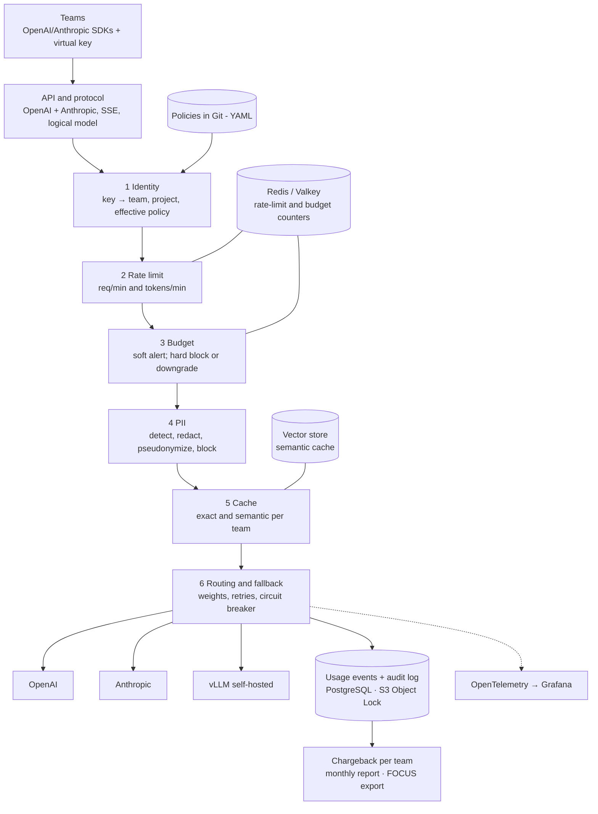

# Tollgate — Product specification

> Source: Appendix A of [`docs/agent/PLAYBOOK.md`](../agent/PLAYBOOK.md). This file is the product specification of record; Spec Kit features in `specs/` refine it.

## A.1 Vision and goals

**Tollgate** is an open-source gateway between engineering teams and model providers that makes AI usage governable: every token has an owner, a budget, a policy and an audit trail. The repository proves it with a report that measures what each policy costs in latency and saves in dollars.

**Problem.** When dozens of teams call OpenAI, Anthropic and self-hosted models directly, the company loses four things: who spent how much (no chargeback), what left the company (PII in prompts), what happens when a provider fails (no fallback), and who did what (no audit). Existing gateways solve parts of this, but several governance features sit behind Enterprise plans ([comparison](https://wz-it.com/en/knowledge/ki/llm-gateway-comparison/)).

**Audience.** Engineering leadership and FinOps (cost per team and product, predictability, risk control); hiring managers for Staff/Principal Platform and AI Infrastructure roles; platform engineers who need an open reference without paywalled governance.

**What the repository must prove (Staff signal).**

1. Governance as a platform product: declarative per-team policies, versioned and audited.
2. FinOps applied to AI: real-time cost attribution per team, soft and hard budgets, monthly chargeback.
3. Engineering with numbers: every policy has measured overhead (p99) and measured effect (savings, availability, risk avoided).

**Success criteria (v1.0).**

| Criterion | Target |
| --- | --- |
| Gateway overhead, all policies on | p99 ≤ 15 ms added (excluding semantic-cache embedding call) |
| Minimal overhead (auth + rate limit + metrics) | p99 ≤ 3 ms |
| Throughput | ≥ 2,000 req/s per 2-vCPU replica against the simulated provider |
| Chargeback precision | ≤ 1% difference between attributed cost and cost recomputed from provider-reported usage |
| Fallback | 0 lost requests during a full outage of one provider; p99 increase documented |
| PII detection | Recall ≥ 95%, precision ≥ 90% on the versioned evaluation dataset |
| Local profile | Everything runs on a laptop with simulated providers, zero cost |
| Bring-up | `make up` local ≤ 5 min; one command; zero leftovers after `make down` |

## A.2 Scope

**In scope (v1.0):** OpenAI-compatible API (`/v1/chat/completions`, `/v1/embeddings`, `/v1/models`) and Anthropic Messages API passthrough (`/v1/messages`) with SSE streaming; providers OpenAI, Anthropic and OpenAI-compatible self-hosted (vLLM/SGLang), Azure OpenAI and Bedrock as optional adapters; teams, projects and virtual keys; per-team/project policies (rate limits, budgets, model allowlist, routing and fallback, exact and semantic cache, PII redaction, log retention); FinOps (versioned price table, per-request cost, aggregation, chargeback CSV/Markdown and FOCUS export); tamper-evident audit log; OpenTelemetry with GenAI conventions and Grafana dashboards; single binary, container image, Helm chart, local Docker Compose or kind profile. **v1.0 uses simulated providers only.**

**Out of scope:** admin web UI; MCP/tool governance; LLM-based content guardrails beyond PII; real billing (invoices, ERP); active-active multi-region with strongly consistent global quotas.

**v2 / post-v1.0:** MCP/tool governance, LLM guardrails, cost/quality model cascading, admin UI, SSO/SCIM team provisioning, global multi-region quotas, **validation with real providers and partner companies**.

## A.3 Architecture



**Request path.** A team calls the API with a virtual key; identity resolves team, project and effective policy; rate limit and budget check counters in Redis; PII redacts or blocks before any cache or provider; the cache answers directly on a hit; routing picks the target and fails over before the first token.

**Cost path.** When the provider responds, actual token usage becomes cost through the price table, written to a usage event and to the hash-chained audit log. Chargeback aggregates events by team, project and cost labels; OpenTelemetry exposes everything in real time.

**Envoy integration.** The same pipeline can run as an `ext_proc` service behind Envoy Gateway / Agent Router (formerly Envoy AI Gateway, renamed when it joined the Agentic AI Foundation in September 2026; v1.1 released August 2026) ([announcement](https://aaif.io/projects/agent-router), [v1.1 release notes](https://theagentrouter.ai/release-notes/v1.1/)). Experiment X7 measures the cost of that hop.

## A.4 Functional requirements

"Must" = required for v1.0; "may" = desirable. Layers follow pipeline order.

### API and protocol

| ID | Requirement |
| --- | --- |
| FR-API-1 | Must expose an OpenAI-compatible API: `/v1/chat/completions`, `/v1/embeddings`, `/v1/models`, with unbuffered SSE streaming. |
| FR-API-2 | Must accept the Anthropic Messages API (`/v1/messages`) in passthrough, applying the same policies. |
| FR-API-3 | Must translate OpenAI-format requests to Anthropic when routing sends a logical model to Anthropic (including streaming and tool calls). |
| FR-API-4 | Logical models: teams call `model: "chat-default"`; the policy resolves provider + real model. |
| FR-API-5 | Errors always in the caller's protocol format, with `x-request-id` and policy headers (`x-tollgate-policy`, `x-tollgate-cost-usd`, `x-tollgate-cache`). |

### Identity and policies

| ID | Requirement |
| --- | --- |
| FR-ID-1 | Must issue virtual keys per team/project (stored hash, visible prefix, expiry, rotation, immediate revocation). |
| FR-ID-2 | May accept JWT/OIDC from an IdP as an alternative, mapping claims to team/project. |
| FR-ID-3 | Provider credentials live only in the gateway (Secret/Vault/env), never exposed to teams. |
| FR-POL-1 | Declarative policies in versioned YAML (GitOps), with org → team → project inheritance and explicit override; no embedded expression language in v1.0. |
| FR-POL-2 | JSON Schema validation and `tollgate policy validate`; hot reload without dropping connections. |
| FR-POL-3 | Per-policy `dry-run` mode: evaluate and record the decision without enforcing. |

### Rate limits and quotas

| ID | Requirement |
| --- | --- |
| FR-RL-1 | Must limit requests/min and tokens/min per key, project and team (token bucket/GCRA or sliding window). |
| FR-RL-2 | Input tokens estimated before the call and reconciled with actual provider usage. |
| FR-RL-3 | State shared across replicas via Redis/Valkey; in-memory mode for dev. |
| FR-RL-4 | 429 responses with `retry-after` and OpenAI-compatible `x-ratelimit-*` headers. |
| FR-RL-5 | May prioritize traffic classes (production vs batch) when the provider quota is saturated. |

### Budgets and FinOps

| ID | Requirement |
| --- | --- |
| FR-FIN-1 | Versioned price table per provider/model (input, output, cached input, batch) with date and source; configurable self-hosted cost model (GPU-hour → cost per token). |
| FR-FIN-2 | Cost computed per request from provider-reported usage and stored in the usage event. |
| FR-FIN-3 | Budgets per team/project (daily, monthly): soft limit alerts; hard limit blocks or downgrades to a cheaper model per policy. |
| FR-FIN-4 | `tollgate chargeback --month <m>` produces a per team/project/model report (CSV + Markdown) and a FOCUS export. |
| FR-FIN-5 | Attributed savings: cost avoided by cache and model downgrade, per team. |
| FR-FIN-6 | Free-form cost labels (cost center, product) propagated from policy to usage events. |

### Routing and fallback

| ID | Requirement |
| --- | --- |
| FR-RT-1 | Logical model → ordered list of targets (provider, model, region) with weights. |
| FR-RT-2 | Fallback on 5xx, provider 429, connect timeout and time-to-first-token timeout; never after the first token reached the client. |
| FR-RT-3 | Circuit breaker per target (error window, half-open) and passive health checks. |
| FR-RT-4 | Retries with exponential backoff and jitter, bounded by a per-request retry budget. |
| FR-RT-5 | Cross-family fallback (OpenAI → Anthropic) only when the policy allows and translation supports the request. |

### Cache

| ID | Requirement |
| --- | --- |
| FR-CACHE-1 | Exact cache (normalized hash of model + messages + deterministic params) with TTL per policy. |
| FR-CACHE-2 | Optional semantic cache: prompt embedding, vector search, per-policy similarity threshold (default 0.92), isolated per team/project. |
| FR-CACHE-3 | Never cache by default: `temperature > 0` (configurable), tool calls, truncated or error responses, prompts with PII detected before redaction. |
| FR-CACHE-4 | Keys versioned by embedding model; invalidation per team/project and per key. |
| FR-CACHE-5 | Cache hits are replayed as a stream when the client asked for streaming. |

### PII

| ID | Requirement |
| --- | --- |
| FR-PII-1 | Must detect PII in prompts (optionally responses): email, phone, card (Luhn), national IDs (SSN, Canadian SIN, CPF), IBAN, IP, names and addresses (optional NER). |
| FR-PII-2 | Actions per policy: `allow`, `redact`, `pseudonymize` (reversible only within the request, restored in the response), `block`. |
| FR-PII-3 | Two-tier detector: Go rules/regex on the hot path; NER (e.g. Microsoft Presidio) as an optional service with timeout and configurable fail mode. |
| FR-PII-4 | Works on streamed responses (sliding token window). |
| FR-PII-5 | No PII value appears in logs, traces, audit log or cache. |

### Audit log

| ID | Requirement |
| --- | --- |
| FR-AUD-1 | One event per request: who (key, team, project), what (logical/real model, provider), every policy decision, tokens, cost, latency, outcome; no content by default. |
| FR-AUD-2 | Append-only with hash chaining (each batch includes the previous hash) and `tollgate audit verify` detecting tampering. |
| FR-AUD-3 | Sinks: rotated JSONL, PostgreSQL, S3 with Object Lock. |
| FR-AUD-4 | Content capture (redacted prompt/response) only by explicit policy, with its own retention. |
| FR-AUD-5 | Admin changes (policies, keys) are audited too. |

### Observability

| ID | Requirement |
| --- | --- |
| FR-OBS-1 | OpenTelemetry traces with one span per pipeline stage and a CLIENT span per provider call using GenAI conventions (`gen_ai.operation.name`, `gen_ai.provider.name`, token usage). |
| FR-OBS-2 | Metrics: `gen_ai.client.token.usage`, `gen_ai.client.operation.duration`, plus own metrics (cost, cache hits, policy decisions, fallback, overhead per stage). |
| FR-OBS-3 | Dashboards: FinOps, reliability, performance, security. |
| FR-OBS-4 | Alerts: budget at 80%/100%, provider circuit open, abnormal PII block rate. |

## A.5 One-command experience

| Command | Behavior |
| --- | --- |
| `make up PROFILE=<p>` | Starts gateway, Redis, Postgres, vector store, OTel Collector, Prometheus, Tempo, Loki, Grafana and simulated providers (local) or applies Helm (k8s). Prints URL, example keys per team, Grafana link. |
| `make demo` | Scripted scenario: three teams generating traffic, one provider failing, one team exhausting its budget, PII prompts. |
| `make smoke` | One call per provider/logical model + checks metrics, trace and audit event. |
| `make bench EXP=<id>` | Runs one experiment and stores results + metadata. |
| `make report` | Generates the evidence report. |
| `tollgate chargeback --month <m>` | Chargeback CSV/Markdown + FOCUS. |
| `tollgate audit verify` | Verifies audit hash-chain integrity. |
| `make down` | Tears everything down. |

| Profile | Where | Providers | Use |
| --- | --- | --- | --- |
| `local` | Docker Compose | Simulators with configurable latency, errors and token usage | Dev, CI, demo, overhead benchmarks |
| `envoy` | kind | Simulators behind Envoy Gateway / Agent Router with tollgate ext_proc | Integration demo and X7 |
| `k8s` | kind or any cluster | Simulators | Helm chart, 3-replica HA, scale tests |
| `live` (post-v1.0) | Local or cluster | Real OpenAI/Anthropic with the operator's keys | Validation with real providers and partner companies; not in the v1.0 report |

## A.6 Evidence and report

The report answers a leadership question: "what does governance cost, and what does it save?". Each policy has a cost (latency, CPU) and an effect (dollars, availability, risk avoided), measured against a no-gateway baseline.

**Metrics:** overhead p50/p99 per policy and cumulative; TTFT overhead for streams; max throughput per replica within the overhead budget; CPU/memory per 1,000 req/s; exact and semantic cache hit rate; semantic false-hit rate (labeled pairs); savings per 1M tokens; PII precision/recall per entity and detector; effective availability during injected outages; chargeback precision.

**Net savings per 1M tokens** of a cache or downgrade policy over the measured window:

```text
savings_1M = ( Σ_r cost_r(without policy) − Σ_r cost_r(with policy) − cost_infra ) / Σ_r tokens_r × 10^6
```

`cost_infra` includes semantic-cache embeddings and the gateway's compute/storage share, so gross savings are never reported alone.

**Workloads:** `support-faq` (high repetition with paraphrases), `rag-mixed` (long context, low repetition; literature suggests 15–25% hit rate), `codegen` (unique prompts, long outputs), `pii-heavy` (30% prompts with synthetic PII), `multi-team` (5 teams with different budgets, 24 h compressed into 1 h), `outage` (constant traffic + partial/full provider failure).

**Experiment matrix (v1.0):**

| ID | Variable | Baseline → variants | Hypothesis |
| --- | --- | --- | --- |
| X1 | Overhead per policy | Direct → passthrough → + auth/rate limit → + PII rules → + PII NER → + semantic cache → all | Full pipeline fits p99 ≤ 15 ms; NER is the most expensive stage |
| X2 | Rate-limit backend | In-memory → Redis → Redis with local leases | Leases cut overhead with ≤ 2% quota error |
| X3 | Cache | None → exact → semantic 0.98 → 0.92 → 0.85 | A threshold maximizes net savings with ≤ 1% false hits on `support-faq`; semantic barely pays on `rag-mixed` |
| X4 | PII detector | Regex → regex + validators → + NER | NER raises recall for names/addresses at a latency cost that needs explicit fail-open/closed |
| X5 | Fallback | None → retry → same-family fallback → cross-family fallback | Cross-family fallback keeps ≥ 99.9% success in a full outage |
| X6 | Budget action | No limit → soft → hard block → hard with downgrade | Downgrade keeps service and lowers team cost vs block |
| X7 | Integration | Standalone Go gateway → policies as ext_proc behind Envoy/Agent Router | Measures the ext_proc hop vs ecosystem reuse |
| X8 | Horizontal scale | 1 → 3 → 6 replicas with shared Redis | Throughput scales ~linearly until Redis bottlenecks; documents the point |

**Protocol:** deterministic simulated providers (seeded latency and tokens); v1.0 uses simulated providers only. 1 min warm-up discarded + 5 min measurement; 5 repetitions; median and range. Load generator in a separate process/container with pinned CPU; metadata: commit, versions, hardware, flags, dataset hashes.

**Report (`report/REPORT.md`):** executive table ("policy X costs Y ms at p99 and saves USD Z per 1M tokens"); per-experiment sections with hypothesis, charts, decision and ADR; waterfall of cost per 1M tokens from no governance to the recommended configuration; example monthly chargeback; threats to validity; how to reproduce.

## A.7 Non-functional requirements

| ID | Area | Requirement |
| --- | --- | --- |
| NFR-1 | Performance | Overhead and throughput targets become CI regression tests (short benchmark against the simulator; fail on > 20% regression). |
| NFR-2 | Reliability | Every dependency failure (Redis, Postgres, vector store, NER) has an explicit per-policy mode, fail-open or fail-closed, always audited. |
| NFR-3 | Security | No prompt/response content in logs by default; secrets only via env/Secret; virtual keys hashed and compared in constant time. |
| NFR-4 | Security | Distroless, non-root, read-only image; SBOM, cosign signature and SLSA provenance; documented STRIDE threat model. |
| NFR-5 | Privacy | Configurable retention for audit log and usage events; documentation of how the gateway supports LGPD/PIPEDA/GDPR (minimization, redaction) without claiming compliance. |
| NFR-6 | Reproducibility | Everything pinned (go.mod, image digests, action SHAs, dated price table); evaluation datasets versioned by hash. |
| NFR-7 | Cost | No CI test calls a real provider; v1.0 has no paid calls at all. |
| NFR-8 | Testing | Unit (≥ 80% on policy packages), contract tests against recorded OpenAI/Anthropic fixtures, e2e on the local profile, fuzzing of protocol parsers and the PII detector. |
| NFR-9 | Operability | Runbooks: provider outage, Redis down, budget exceeded, PII false positive, provider key rotation, audit verification. |
| NFR-10 | Compatibility | Official OpenAI and Anthropic SDKs (Python, TypeScript, Go) work by changing only `base_url` and key; tested in CI. |
| NFR-11 | License | Apache-2.0. |

## A.8 Repository layout

```text
tollgate/
├── cmd/tollgate/              # binary: serve, sim, load, policy, keys, chargeback, audit, bench, extproc
├── internal/
│   ├── api/                   # OpenAI and Anthropic handlers, SSE
│   ├── canonical/             # internal request model
│   ├── translate/             # OpenAI ↔ Anthropic
│   ├── pipeline/              # Stage interface and runner
│   ├── identity/ policy/ ratelimit/ budget/ pricing/ usage/ finops/
│   ├── routing/ cache/ pii/ audit/
│   ├── providers/             # openai, anthropic, openaicompat, azure, bedrock
│   ├── extproc/               # Envoy ext_proc adapter
│   ├── bench/
│   └── telemetry/
├── sim/                       # simulated providers
├── policies/examples/         # org.yaml, teams/*.yaml
├── pricing/                   # versioned price tables
├── schemas/                   # JSON Schemas (policy, pricing, sim, usage event, results, metadata)
├── deploy/
│   ├── compose/               # local profile
│   ├── kind/                  # envoy and k8s profiles
│   ├── helm/tollgate/
│   └── observability/         # collector config, rules
├── dashboards/
├── bench/{workloads,experiments,datasets,results,k6}/
├── report/
├── testdata/wire/{openai,anthropic}/
├── docs/{adr,runbooks,security,finops,product,agent}/
├── specs/                     # Spec Kit features (NNN-short-name/)
└── .github/
```

Conventions: every policy is a `Stage` with the same interface, its own span, metric and micro-benchmark; experiments are YAML; results are never hand-edited; Conventional Commits, DCO, small PRs linked to spec and ADR.

## A.9 Decisions already taken (by the maintainer)

| Decision | Choice | Consequence |
| --- | --- | --- |
| Architecture | Standalone Go gateway with optional ext_proc adapter | Tollgate owns the pipeline end to end; the adapter proves Envoy/Agent Router integration and X7 measures the hop cost. |
| Policy language | YAML with inheritance | Easy to review in PRs and validate with JSON Schema; no CEL/Rego in v1.0 (recorded in ADR-0005 as future evolution). |
| Name | `tollgate` | Repository, binary, Go module and header prefix (`x-tollgate-*`). |
| Providers in the v1.0 report | Simulated only | Zero cost and deterministic results; validation with real providers and partner companies is post-v1.0. |

## A.10 ADR index (planned)

| ADR | Topic | Decided by |
| --- | --- | --- |
| 0000 | Record architecture decisions | Feature 001 |
| 0001 | Standalone Go gateway + optional ext_proc adapter | Maintainer (documented in 003) |
| 0002 | State stores: Redis/Valkey + PostgreSQL | Feature 003 |
| 0003 | Vector store for the semantic cache | Feature 013 |
| 0004 | PII strategy: Go rules + optional Presidio | Feature 011 |
| 0005 | Policy model: YAML with inheritance | Maintainer (documented in 005) |
| 0006 | Cost export format: FOCUS | Feature 006 |
| 0007 | Audit integrity: hash chain + object lock | Feature 012 |
| 0008 | Default semantic-cache threshold | X3 (initial in 013) |
| 0009 | Simulated providers as the default upstream | Feature 002 |
| 0010 | Canonical internal request model | Feature 004 |
| 0011 | Fallback semantics for streaming | Feature 009 |
| 0012 | Telemetry naming behind one package | Feature 010 |
| 0013 | Load generator | Feature 016 |
| 0014 | Report generator in Python | Feature 017 |
| 0015 | Documentation site tooling | Feature 018 |

## A.11 Risks

| Risk | Impact | Mitigation |
| --- | --- | --- |
| Overhead above budget with PII/NER and semantic cache | Gateway becomes the bottleneck | Rules on the hot path, NER optional, embeddings with timeout; X1 measures and the report recommends combinations |
| Semantic cache serving wrong answers | Quality and trust risk | Off by default, per-team isolation, per-policy threshold, exclusions (temperature, tools); X3 measures false hits |
| Provider API changes (new fields, Responses API) | Translation breaks | Contract tests with recorded fixtures, passthrough as fallback, pinned SDK versions |
| OTel GenAI conventions still in development | Attribute names change | Names centralized in one package; normalize in the Collector ([status](https://www.dash0.com/knowledge/opentelemetry-genai-semantic-conventions-explained)) |
| Provider price changes | Inaccurate chargeback | Dated price table with source, alert on unknown model, reconciliation with raw usage |
| Mature competitors (LiteLLM, Agent Router, Portkey, Kong) | Project looks redundant | Position as the governance reference + evidence report; integrate with Agent Router via ext_proc (X7) |
